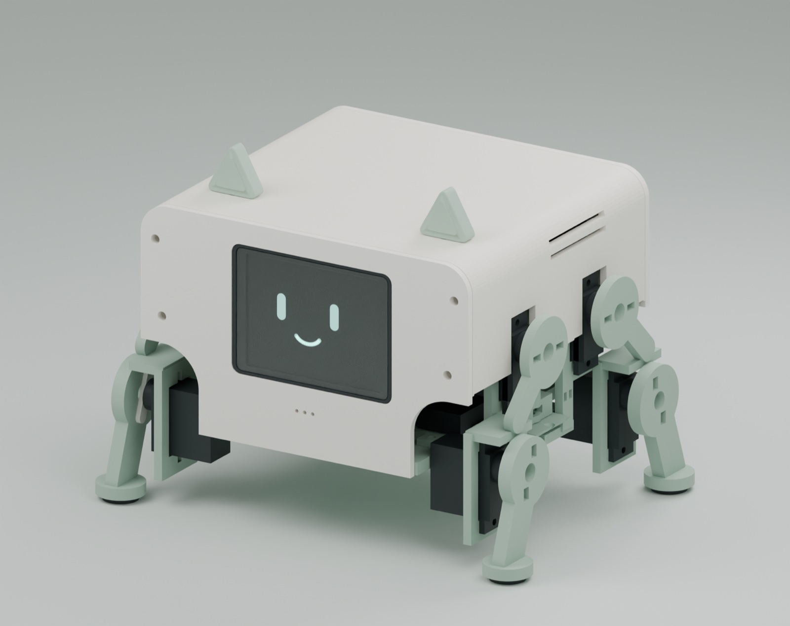

# 爬爬 · ESP32-S3 四足智能桌面助手

> 一台会做表情、能联网看天气、可以用手机网页远程戳一戳的低成本桌面小机器人。
> 硬件（PCB / 结构件）、两套固件、网页控制台**全部开源**。



<sub>structure-a5 的 Blender 渲染（非实物照片）：机身 124×112×76 mm，四足站姿 162.9×116.5×122.46 mm。</sub>

当前阶段：**桌面原型联调**。屏幕、联网、网页控制、双舵机台架已经实机跑通；
语音闭环、八舵机步态、电池整机供电与实体装配仍在推进。逐项状态以
[项目进度总览](项目进度总览.md) 为准。

---

## 一、这个项目能做什么

| 能力 | 状态 | 说明 |
|---|---|---|
| 表情 / 动画 | ✅ 已实现 | 2.4″ 彩屏；6 个信息页 + 3 部 GIF 动画，共 9 屏 |
| 时钟 / 日历 | ✅ 已实现 | 数字钟 + 指针表盘，NTP 自动对时 |
| 天气 | ✅ 已实现 | 和风天气，含今日温度区间、湿度、体感、风力 |
| 账号额度 | ✅ 已实现 | 自建 sub2api 账号状态与剩余额度 |
| 旋钮 / 按键交互 | ✅ 已实现 | EC11 旋转切页，按下确认，独立键自定义 |
| 网页远程控制 | ✅ 已实现 | 切屏、换表情、远程画面、状态回传（WSS 中转） |
| 舵机动作 | 🟡 台架验证 | 两路 PWM 已实测；八路与步态未做 |
| 语音对话 | 🔴 未实现 | 麦克风与功放已选型接线，录音→ASR→TTS 链路空白 |
| 四足行走 | 🔴 未实现 | 结构件已出，步态算法未开始 |

### 硬件规格

| 项目 | 参数 |
|---|---|
| 主控 | LCKFB-ESP32S3R8N8（ESP32-S3，8 MB Flash + 8 MB Octal PSRAM） |
| 屏幕 | TOUGLESY 2.4″ ST7789，320×240，四线 SPI，**3.3 V**，背光常亮 |
| 交互 | EC11 旋转编码器（A/B/按压）+ 1 个独立按键 |
| 舵机 | 计划 8 × MG90S（每腿 2 个）；台架当前 2 路，GPIO18 / GPIO15 |
| 麦克风 | INMP441（I²S 数字麦），BCLK=4 / WS=5 / SD=6 |
| 功放 | MAX98357A + 喇叭（已选型，未接） |
| 电源 | 格氏 ACE 800mAh 2S 7.4V + HX-2S-JH20 保护均衡板 |
| 结构 | structure-a5：机身 124×112×76 mm，站姿 162.9×116.5×122.46 mm |
| PCB | integrated-v1 V1.2：110×75 mm 双层集成板（无旋钮版） |

> ⚠️ 舵机实物型号（MG90S / SG90）与到货数量需要对着实物复核，不能只信采购记录。
> 本节参数是**选型值**，不是整机负载实测值。

---

## 二、目录结构

```
papabot/
├── firmware/                     两套固件 + 网页控制台
│   ├── bringup/                  ① 硬件自检工程（bench-v1）
│   │   ├── wiring.json           ★ 接线真值源（引脚、屏幕、舵机、麦克风）
│   │   ├── include/
│   │   │   ├── board_config.h    由 wiring.json 生成，**不要手改**
│   │   │   └── control_logic.h   纯命令解析逻辑（可主机测试）
│   │   ├── src/main.cpp          外设驱动 + 串口命令台
│   │   ├── scripts/              setup / pio / 生成器 / 文档渲染 / 导出
│   │   ├── test/                 主机单元测试
│   │   └── docs/                 接线图、速查卡、故障对照、验收记录
│   ├── assistant/               ② 产品固件（表情 + 信息面板）
│   │   ├── platformio.ini        两个 env：UART 控制台 / 原生 USB 控制台
│   │   ├── partitions-assistant-8mb.csv  单 app 6.875 MB 分区表
│   │   ├── include/              config.h（引脚/配色/刷新周期）、canvas.h …
│   │   ├── src/                  main / apps / canvas / anim / net / cloud / font
│   │   ├── data/                 anim.bin（动画）、cjk16.bin / cjk24.bin（中文字库）
│   │   └── scripts/              字库与动画生成器、主机测试
│   └── web-console/              ③ 网页控制台与服务端中转
│       ├── server/server.js      papa-relay：WSS 中转 + /api/*
│       ├── www/index.html        单页控制台
│       └── docker-compose.yml
├── pcb-design/                   PCB 三条版本线（RevA / RevB / integrated-v1）
├── mechanical-design/            Blender 结构（A2–A5）、STL、渲染、打印预案
├── hardware-selection/           选型与 BOM：电池、舵机、屏幕、供电、采购清单
├── design-coordination/          PCB × 结构接口约定
├── design-selection.json         全部选型与决定的结构化记录
├── 项目进度总览.md               ★ 当前进度的唯一权威入口
├── PROGRESS.md                   历史进度（已被总览取代，保留追溯）
└── docs/交接说明-2026-09-12.md   旧的交接说明（历史）
```

三个「真值源」要记住：

1. **引脚 ↔ 硬件** → `firmware/bringup/wiring.json`
2. **当前进度** → `项目进度总览.md`
3. **产品行为** → `firmware/assistant/include/config.h`

---

## 三、环境依赖与安装

### 3.1 硬件

- LCKFB-ESP32S3R8N8 开发板（**必须是 8 MB Flash + 8 MB PSRAM**，N8R8）
- TOUGLESY 2.4″ ST7789 模块（12 针，含 EC11）
- **外部 3.3 V** 给屏幕（模块 VCC 与 BLK）、**外部 5 V** 给舵机
- USB **数据**线（不是只能充电的线）

### 3.2 软件

| 依赖 | 版本 | 用途 |
|---|---|---|
| Python | ≥ 3.9 | 生成器、主机测试 |
| PlatformIO | 6.1.18 | 编译 / 烧录 |
| Node.js | ≥ 20 | 网页控制台中转服务 |
| Pillow | 任意近期版 | 字库与 GIF 转动画 |

### 3.3 安装步骤

```bash
git clone https://github.com/xaiojie/papabot.git
cd papabot

# 建一个隔离的 PlatformIO 环境（会生成 firmware/bringup/.venv）
bash firmware/bringup/scripts/setup.sh
```

脚本内容相当于：

```bash
python3 -m venv firmware/bringup/.venv
firmware/bringup/.venv/bin/python -m pip install "platformio==6.1.18" "urllib3<2"
```

编译时**必须屏蔽 `PYTHONPATH`**：

```bash
env -u PYTHONPATH bash firmware/bringup/scripts/pio.sh run -e lckfb_s3_usbjtag
```

> **为什么**：某些托管环境会往 `PYTHONPATH` 注入 Python 垫片，导致
> `generate_wiring.py` 里的 `Path.mkdir(exist_ok=True)` 抛 `PermissionError`
> （不是 `FileExistsError`，`exist_ok` 拦不住），prebuild 直接失败、整个编译挂掉。

网页控制台（可选，本地跑）：

```bash
cd firmware/web-console/server
npm install && PAPA_PORT=8790 npm start     # 默认监听 8790
```

---

## 四、编译与烧录

两套固件共用同一块板子，**分工不同**：

| 工程 | 用途 | 适合什么时候烧 |
|---|---|---|
| `bringup` | 硬件自检台：屏幕彩条、旋钮计数、麦克风电平、舵机单步 | 接线后第一次上电、怀疑硬件坏了 |
| `assistant` | 产品固件：表情、时钟、天气、动画、网页控制 | 硬件确认没问题之后 |

### 4.1 选端口与环境

```bash
ls /dev/cu.*          # macOS
```

| 端口 | 对应 env | 说明 |
|---|---|---|
| `/dev/cu.usbmodem*` | `lckfb_s3_usbjtag` | **原生 USB-Serial/JTAG，免装驱动**（推荐） |
| `/dev/cu.wchusbserial*` | `lckfb_s3_bringup` / `lckfb_s3_assistant` | 板载 CH340K，需装 CH34x 驱动 |

### 4.2 烧录

```bash
# 硬件自检
env -u PYTHONPATH bash firmware/bringup/scripts/pio.sh run \
    -e lckfb_s3_usbjtag -t upload --upload-port /dev/cu.usbmodemXXXX

# 产品固件
cd firmware/assistant
env -u PYTHONPATH bash scripts/pio.sh run \
    -e lckfb_s3_usbjtag -t upload --upload-port /dev/cu.usbmodemXXXX
```

烧不进去时：按住 **BOOT** → 点一下 **RESET** → 松开 BOOT，进下载模式重试。
烧完按 RESET 正常启动，**不要一直按住 BOOT**。

### 4.3 主机测试（不用板子）

```bash
# bringup：命令解析逻辑
python3 firmware/bringup/scripts/test_host.py

# assistant：脏矩形与 SPI 预算
python3 firmware/assistant/scripts/test_host.py
```

---

## 五、配置说明

### 5.1 引脚表（权威值，改硬件请改 `wiring.json`）

| 功能 | GPIO | 位置提示 |
|---|---|---|
| LCD_SCLK | 12 | 左列 L13 |
| LCD_MOSI | 11 | 左列 L12（模块丝印写 `SDA`，**不是 I²C**） |
| LCD_RST | 21 | 右列 R10 |
| LCD_DC | 14 | 左列 L15 |
| LCD_CS | 13 | 左列 L14 |
| ENC_A / ENC_B | 7 / 2 | L8 / L2 |
| ENC_PUSH | 38 | R13（按下为低） |
| KEY0 | 40 | R11（按下为低） |
| SERVO0 / SERVO1 | 18 / 15 | 台架试验脚，**不代表载板已有舵机座** |
| MIC_BCLK / WS / SD | 4 / 5 / 6 | INMP441，L/R 接地选左声道 |
| LED | 48 | 低电平点亮 |
| BOOT | 0 | 低电平有效 |

> 屏幕 `VCC` 与 `BLK` **只能接 3.3 V**。RevA 时代用 5 V，旧习惯必须丢掉。

### 5.2 两套固件的配置入口不同

**`bringup`：改 `wiring.json`，不要改生成的头文件**

```bash
vim firmware/bringup/wiring.json
env -u PYTHONPATH python3 firmware/bringup/scripts/generate_wiring.py
```

`generate_wiring.py` 会校验 GPIO 冲突、位置合法性和重复占用，然后生成
`include/board_config.h`。手改 `board_config.h` 会在下次构建时被覆盖。

**`assistant`：直接改 `include/config.h`**

| 配置项 | 默认值 | 说明 |
|---|---|---|
| `SCREEN_W/H` | 320×240 | 逻辑分辨率（横屏） |
| `PANEL_NATIVE_W/H` | 240×320 | **面板原生尺寸，必须竖屏传参**，传反会导致画面转 90° 且地址回绕 |
| `SCREEN_ROTATION` | 3 | 横屏 |
| `SCREEN_INVERT` | false | 这块模组设 true 会变白底暗红 |
| `SPI_HZ_DEFAULT` | 10 MHz | 提到 40 MHz 可到 ~33 fps，但需实测时序 |
| `SERVO_COUNT / SERVO_PINS` | 2 / {18, 15} | 加第三路：改这两个即可 |
| `SERVO_MIN_US / MAX_US` | 1000 / 2000 | 完整 0–180°；顶到机械限位要自己往回收 |
| `WEATHER_REFRESH_MS` | 20 min | 和风免费版有日调用上限 |
| `QUOTA_REFRESH_MS` | 5 min | 额度变化比天气频繁 |
| `NET_RETRY_MS` | 60 s | 失败重试，否则断网开机永远空状态 |

### 5.3 运行期配置（写进 NVS，掉电不丢）

凭据**不写进源码**，只在设备上用串口命令配置：

```
wifi connect <SSID> <密码>        连接并保存，开机自动重连
wifi connect <SSID> <密码> ram    只连本次，不保存
wifi forget                       清除已保存的凭据
cloud key <密钥>                  配置云端设备密钥
set qwkey <和风 Key>              天气 API Key（值不回显）
set qwhost <API Host>             和风项目 API Host
```

`config` 命令可以查看当前存了什么（密钥只显示"已设置/未设置"）。

### 5.4 分区表

`assistant` 用自定义的 `partitions-assistant-8mb.csv`：

```
nvs       0x9000   0x5000
app0      app,factory  0x10000  0x6E0000   (6.875 MB，单 app、无 OTA、无 SPIFFS)
coredump  0x6F0000 0x10000
```

- 这台设备**不用 OTA、不用文件系统**：字库和动画在编译期通过 `embed_files` 直接进 flash。
- `nvs` 偏移与 PlatformIO 默认的 `default_8MB.csv` 一致，所以换表**不会丢 Wi-Fi 凭据**。
- `bringup` 仍用 `default_8MB.csv`（它的发布包按原布局做过哈希），两个工程分区表**故意不一致**。

### 5.5 资源文件

| 文件 | 生成方式 | 说明 |
|---|---|---|
| `data/cjk16.bin` / `cjk24.bin` | `scripts/make_cjk_font.py` | GB2312 4444 字形，16 / 24 px |
| `data/anim.bin` | `scripts/make_gif_anim.py` | GFX1 v2 动画包，当前 3 部 |

```bash
# 字库
python3 scripts/make_cjk_font.py

# 动画：路径后面加 :2 表示按步长 2 抽帧
python3 scripts/make_gif_anim.py a.gif "b.gif:2" -o data/anim.bin --preview
```

> **字库许可**：当前 16/24 px 字模取自 macOS 自带字体，**仅限自用**。
> 对外发布或商用前必须换成思源黑体 / Noto Sans CJK 等可再分发字体。

---

## 六、主要模块与核心逻辑

### 6.1 为什么架构长这样：SPI 带宽是硬上限

面板是**只写 SPI**（没有 MISO），10 MHz 下推一屏 320×240 要：

```
320 × 240 × 2 字节(RGB565) = 153,600 B
153,600 × 8 / 10,000,000   ≈ 123 ms  →  8 fps 封顶
```

所以**绝不能每帧全屏重绘**，否则动画一顿一顿。于是有了下面两条设计：

1. **帧缓冲放 PSRAM**（153,600 B，SRAM 装不下），Canvas 在内存里画完再推。
2. **脏矩形局部刷新**：只把发生变化的矩形区域推给屏幕。
   实测表情页脏矩形 160×136 → **37.8 ms**，比全屏 133 ms 快 3.5 倍。

### 6.2 `bringup`（硬件自检台）

| 文件 | 作用 |
|---|---|
| `wiring.json` | 接线真值源，生成 `board_config.h` |
| `include/control_logic.h` | 纯命令解析（无硬件依赖）→ 可在 PC 上跑单元测试 |
| `src/main.cpp` | 屏幕 / 舵机 / 麦克风 / 编码器驱动 + 串口命令台 |

设计要点：**解析逻辑与硬件驱动分离**。`control_logic.h` 只把字符串变成命令结构体，
不碰任何外设，因此 16 组、293 项断言能在主机上跑完，不用反复烧板子。

状态机是显式的：`PASSIVE`（什么都不初始化）↔ `SCREEN` ↔ `SERVO`。
`screen` 与 `servo` 互斥，切过去要先 `stop`。

### 6.3 `assistant`（产品固件）

| 文件 | 作用 |
|---|---|
| `main.cpp` | 启动流程、主循环、串口命令台、云端命令桥 |
| `apps.cpp` | 9 个页面：表情 / 数字钟 / 表盘 / 天气 / 额度 / 状态 + 每部动画一页 |
| `canvas.cpp` + `dirty.h` | 帧缓冲、RGB565 绘制、脏矩形累积与推屏 |
| `anim.cpp` | GFX1 v2 解码：第 0 帧整存，其后叠加差分 |
| `net.cpp` | Wi-Fi、NTP、HTTP（天气 / 额度） |
| `cloud.cpp` | WSS 客户端，连 `papa.papaclaoud.top` 中转 |
| `font_ascii.cpp` | ASCII 字模；中文走 `cjk*.bin` 查表 |

**启动顺序**（串口能看到对应日志）：

```
boot: config → spi → panel init → panel ok → canvas
     → anim 载入 → framebuffer 分配 → CJK 字库 → inputs
     → goto face → 自动连 Wi-Fi → NTP → cloud WSS → READY
```

**页面编号**：`0`face `1`clock `2`analog `3`weather `4`chatgpt `5`sys，
之后每部动画占一页 → 当前 3 部动画共 **9 页（0–8）**。旋钮转动即切页。

**动画格式（GFX1 v2）**

```
Header : "GFX1" | u8 version=2 | u8 count | u16 reserved
Record : u16 w,h,frames,delayMs,reserved | u32 paletteOff | u32 frameIndexOff | u32 dataOff
Frame0 : w*h 字节索引，整帧
FrameN : [u32 start | u16 run | run 字节] × N | u32 0xFFFFFFFF
```

`start` 是**绝对像素位置**，不是"相对跳过"。v1 用 `u16 start`，单帧像素数硬上限
65535 —— 320×240（76800）根本编不出来，所以升到 v2 时把 `start` 放宽到 u32。
**脚本的 `VERSION` 与 `anim.cpp` 的 `kFormatVersion` 必须同步**，不一致固件会拒绝加载。

### 6.4 `web-console`（papa-relay）

- Node.js + `ws`，默认端口 **8790**（`PAPA_PORT` 可改）
- 两个 WSS 通道：设备主动连上来 + 浏览器连上来，服务端做双向转发
- HTTP 接口：`/api/health`、`/api/login`、`/api/status`、`/api/device/ping`
- 部署实例：<https://papa.papaclaoud.top/>

设备端在 `cloud.cpp` 里主动连出，所以**不需要公网 IP、不需要端口映射**。

---

## 七、启动与使用方法

### 7.1 开机

1. 接 USB（或电池），板载 LED 1 Hz 心跳 = 主控在跑。
2. 屏幕先黑一下再出表情页。
3. 串口打印 `READY.` 后即可接命令。
4. Wi-Fi 若已保存过凭据会自动重连，随后自动同步 NTP、拉天气与额度。

### 7.2 实体操作

| 操作 | 效果 |
|---|---|
| 转旋钮 | 上/下一页（顺时针下一屏） |
| 按旋钮 | 当前页确认 / 换情绪 |
| 按独立键 | 页面自定义动作 |

### 7.3 串口命令台（115200）

```
help | status | stats [on|off] | dump | dumpr
next | prev | screen <0-8|name>
mood [next]                     换表情情绪
ntp                             立即对时
wifi connect/forget/status/scan/off
cloud status | cloud key <密钥> | cloud forget
set nick / qwhost / qwkey / qwloc / subhost / adminkey / account / subkey
quota | usage | weather         立即拉取
spi <10|20|40>                  改 SPI 时钟
servo arm|center|stop [n]       舵机上电回中 / 松力（n 省略=全部）
servo pulse [n] <1000-2000>     设脉宽
servo status                    各路状态
config                          查看已存配置
```

> 有些命令（`dump` / `dumpr`）会输出几十万字节，读的时候记得别设太短的超时。
> **不要把"返回空串"当成命令结束** —— 偶发一次空回不代表命令不存在，重发即可。

### 7.4 网页控制台

打开 <https://papa.papaclaoud.top/> → 登录 → 能看到设备在线状态、点按钮切屏/换表情、
开远程画面（约 4.5 fps，按浏览器连接数自动开关推流）。

---

## 八、常见问题（FAQ）

### 屏幕整块纯白

**先别拆线。** `bringup` 复位后停在 `PASSIVE`，这个状态**一行屏幕初始化都不发**，
而 `BLK` 接的是 3.3 V 常亮 → 面板有电、没命令 → 肉眼就是纯白。

```
screen start
```

出彩条即正常。真正要查线的情况是：**已经 `screen start` 之后**还是白的。

### 串口一回 `SCREEN active`，但屏还是不亮

正常。ST7789 **只写、没有 MISO**，固件根本读不回面板状态。
`SCREEN active` 只证明"初始化命令发出去了"，**判断屏幕只能靠眼睛**。

### 每次打开串口设备就重启

预期。打开 `/dev/cu.usbmodem*` 会触发复位（`USB_UART_CHIP_RESET`），
所以**一批命令必须在同一次串口会话里发完**，否则状态全丢。

### 编译报 `PermissionError` / prebuild 失败

`PYTHONPATH` 垫片问题，加 `env -u PYTHONPATH` 前缀：

```bash
env -u PYTHONPATH bash scripts/pio.sh run -e lckfb_s3_usbjtag
```

### `pio.sh` 说找不到 PlatformIO

仓库自带的 `.venv` / `.tools` 不在版本库里，需要自己建：

```bash
bash firmware/bringup/scripts/setup.sh
```

`pio.sh` 的查找顺序：`.tools/bringup-venv/bin/pio` → `工程/.venv/bin/pio` → `PATH`。

### 串口列表里看不到设备

先换一根**数据线**；再看是不是选错了口。同一块板可能同时出现原生 USB 和 CH340 两个口，
**不要凭列表顺序选**。

### 舵机不动 / 一直嗡嗡响 / 发热

- 不动：确认已 `servo arm`（未 arm 时 PWM 根本没开）、外部 5 V 是否上电、信号线是否接对。
- 嗡嗡响 = **堵转**，该端已顶到机械限位，**立刻断电**，把该端脉宽往中间收（如 600/2350）。
- 10 秒没新指令会自动松力（停 PWM，**但没有断舵机电源**）。
- 舵机 5 V **必须外部供电**，不能从开发板取。

### 中文显示成方块 / 乱码

`data/cjk*.bin` 没被链接进去。检查 `platformio.ini` 的 `board_build.embed_files`，
并确认文件确实存在（它们是二进制资源，不是 git 忽略项）。

### 动画屏只画一半 / 花屏

先确认 `anim.bin` 的版本与固件匹配（`GFX1` 后第 5 个字节应为 `2`）。
脚本和 `anim.cpp` 版本不一致时，固件会打印"版本不支持"并拒绝加载 —— 重新生成即可。

### 天气 / 额度一直是空的

按顺序查：`wifi status` → 有没有 IP；`ntp` → 时间是否有效；
`config` → `qwkey` / `subkey` 是否已设置。HTTP 失败会 60 s 后重试，也可以 `weather` / `quota` 立即拉。

### 网页控制台连不上设备

看设备串口是否打印 `[cloud] ✅ 已连上中转服务`。断线会自动重连；
若一直失败，检查 `cloud key` 是否配置、网络是否能出 443。

---

## 九、安全红线与注意事项

1. **屏幕 VCC 和 BLK 只能 3.3 V。** 接 5 V 可能不可逆损坏。
2. **屏幕不允许单独带电。** 控件上拉接在屏幕 VCC 上，屏幕带电而主控没电会经信号线倒灌。
3. **任何接线动作前，USB 和外部电源都必须断开。** 不允许带电插拔杜邦线。
4. **不要让外部 3.3 V 正极接到开发板的 3V3 / 5V 排针。** 两边各自供电、只共地。
5. **舵机 5 V 走外部独立供电**，与逻辑 5 V 只共地不并联。
6. **上电顺序**：先 USB、确认 `PASSIVE`，再开外部 3.3 V；断电反过来。
7. **凭据不入库。** `wifi` 口令、和风 Key、云端密钥都只写设备 NVS，源码里没有。
8. **字库需要替换。** 当前字模来自 macOS 自带字体，发布/商用前必须换可再分发字体。
9. **脉宽 ≠ 角度。** `1000–2000 µs` 是电气行程，装上腿以后每个关节要单独标定。

---

## 十、还没验证的部分（别当成已完成）

- 八舵机同时动作的**电源能力、压降、发热**（只测过两路空载）
- 屏幕最大电流、主控稳压余量、温升
- 电池**充电电流与保护板实际限流**（0.353 A 是公式值）
- 整机续航、承重、步态
- 语音闭环（录音 → ASR → 对话 → TTS）
- PCB 打样/焊接/上电，结构件实物打印与试装
- 新屏 HS24S010B（无旋钮版）点亮与固件适配

---

## 十一、文档索引

| 想看什么 | 去哪 |
|---|---|
| **当前进度（权威）** | [项目进度总览.md](项目进度总览.md) |
| 产品固件的设计与踩坑 | [firmware/assistant/README.md](firmware/assistant/README.md) |
| 硬件自检与接线 | [firmware/bringup/README.md](firmware/bringup/README.md) · [接线总图](firmware/bringup/docs/index.html) |
| 通电前自检与故障对照 | [通电前自检与故障对照.md](firmware/bringup/docs/通电前自检与故障对照.md) |
| 舵机接线 | [舵机接线.md](firmware/bringup/docs/舵机接线.md) |
| PCB 三版本 | [integrated-v1](pcb-design/integrated-v1/) · [native-rev-b](pcb-design/native-rev-b/) · [RevA](pcb-design/native-rev-a/) |
| 结构版本 | [mechanical-design/当前结构版本.md](mechanical-design/当前结构版本.md) |
| 选型与采购 | [hardware-selection/](hardware-selection/) · [采购清单](采购清单-20260912/) |
| 网页控制台部署 | [firmware/web-console/部署记录.md](firmware/web-console/部署记录.md) |

---

## 许可

本项目采用 **MIT License**，见 [LICENSE](LICENSE)。固件、网页控制台、PCB 与结构设计文件一并适用。

几点说明：

- **第三方资料不在本许可范围内**：芯片/模块数据手册、厂商规格书、商品图片的版权归各自所有者。
- **字库需要在发布前替换**：当前 `cjk*.bin` 由 macOS 自带字体生成，仅限自用；
  换思源黑体 / Noto Sans CJK（SIL OFL）后可再分发，详见 [5.5 节](#55-资源文件)。
- 如果你希望硬件部分使用**带传染性的**硬件许可，可换成
  [CERN-OHL-S-2.0](https://ohwr.org/cern_ohl_s_v2.txt)；当前用 MIT 是为了让复用门槛最低。

