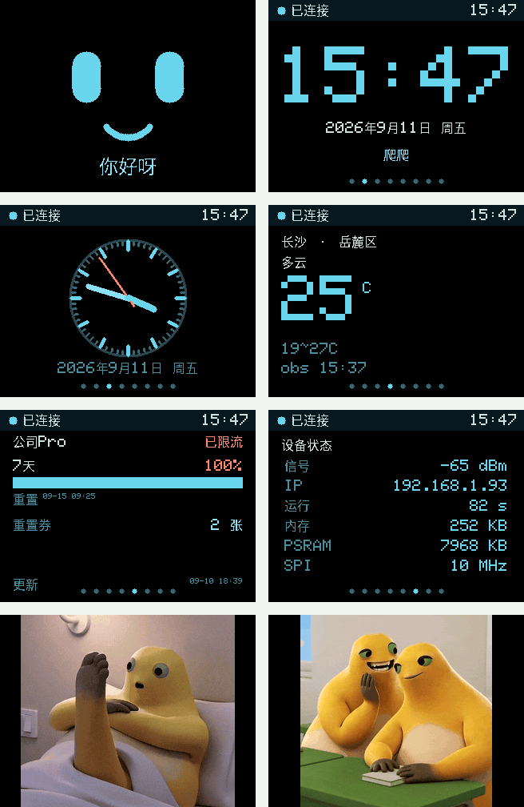
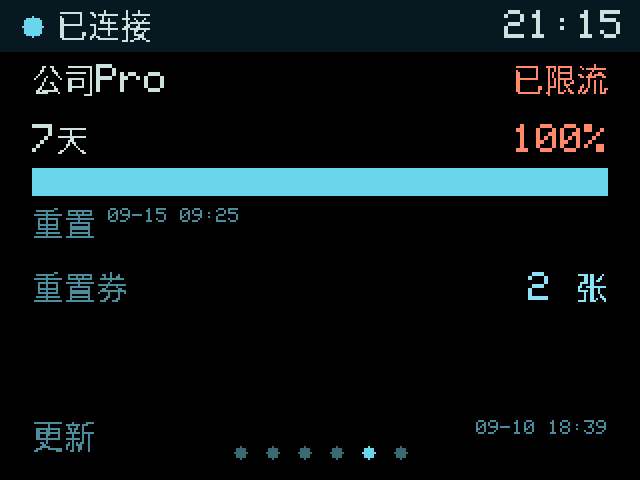

# 桌面助手 · 应用固件（assistant）

两个程序、六屏，旋钮循环切换。这是**产品固件**；`../bringup/` 是硬件自检工具，两者分工不同、互不覆盖。

| | bench-v1（bringup） | assistant（本工程） |
|---|---|---|
| 目的 | 把主控/屏幕/舵机三条硬件通路测通 | 真正跑起来的桌面助手界面 |
| 结构 | 串口命令 + 单屏自检画面 | 六屏应用框架 + 网络 + 配置 |
| 屏幕 | 只画色条和控件计数 | 表情动画 / 时钟 / 天气 / 用量 / 状态 |

---

## 一、架构：为什么必须做脏矩形

ST7789 @10 MHz 的传输时间是硬约束：

| 区域 | 像素 | 字节 | 传输 | 上限 |
|---|---:|---:|---:|---:|
| 全屏 320×240 | 76,800 | 153,600 | **133 ms**（实测） | **7.5 fps** |
| 表情动态区 160×136 | 21,760 | 43,520 | **37.8 ms**（实测） | **26 fps** |

**所以绝不能每帧全屏重绘**——全屏只有 7.5 fps，动画会一顿一顿。

固件结构：

```
PSRAM 全帧缓冲（150 KB，8 MB PSRAM 里随手放）
   ↓ 每个绘图基元自动把自身范围并进脏矩形
   ↓ 提交时只把脏矩形用 setAddrWindow + writePixels 推给屏
```

设计取舍：**绘图基元自动标脏**，而不是让应用层手工调 `damage()`。手工标脏性能略好，但漏标就会花屏；自动并集多算一点点，但不会出错。

### 实测帧率（2026-09-10，真机 LCKFB-ESP32S3R8N8 @10 MHz）

| 屏幕 | 脏矩形 | 每帧字节 | 传输 | 帧率 | 说明 |
|---|---|---:|---:|---:|---|
| ① 表情 | 160×136 | 43,520 | 37.8 ms | **23 fps** | 眨眼/视线/呼吸，动得起来 |
| ③ 表盘 | 320×230 | 147,200 | 127.9 ms | **1.0 fps** | 每秒整盘重绘一次，占空比 12.8% |
| ② 数字钟 | 320×230 | 147,200 | 127.9 ms | **0 fps** | 只在分钟变化时刷 |
| ④ 天气 | 320×240 | 153,600 | 133.1 ms | **0 fps** | 静态屏，不浪费带宽 |
| ⑤ ChatGPT | — | — | — | 0 fps | 同上 |
| ⑥ 状态 | 320×240 | 153,600 | 133.2 ms | 1 fps | 每秒刷新一次数值 |

> 表盘选择「每秒整盘重绘」而不是「擦掉旧指针」：整盘 127.9 ms 但每秒只有一次，
> 占空比才 12.8%；而擦旧指针会把指针划过的刻度和外圈一起擦掉，容易出错。

**没接屏幕也能验证**：上面这些数字全部来自串口的 `stats` 遥测，不是估算。

---

## 二、串口命令

| 命令 | 作用 |
|---|---|
| `help` / `status` | 帮助 / 运行状态、时间、网络、天气状态 |
| `stats [on\|off]` | 帧遥测：脏矩形、字节数、传输耗时、帧率。`off` 同时关掉心跳 |
| `next` / `prev` | 上/下一屏 |
| `screen <0-N\|名字>` | 切屏。`N = 6 + 动画部数 - 1`，当前 3 部动画即 **0..8**。名字：`face` `clock` `analog` `weather` `chatgpt` `sys` `anim`（`anim` 只能定位到第 1 部动画，后面的用序号） |
| `mood [next]` | 切换表情情绪（happy/curious/surprised/sleepy/sad） |
| `ntp` | 启动 NTP 对时 |
| `wifi connect <SSID> <密码>` | **连接并写入 NVS，开机自动重连**；口令不回显。末尾加 `ram` 则只连本次、不保存 |
| `wifi forget` | 清除已保存的凭据 |
| `wifi status` / `wifi scan` / `wifi off` | 查看 / 扫描 / 断开 |
| `set nick <文字>` | 昵称，写入 NVS（默认「爬爬」） |
| `set qwhost <API Host>` | 和风项目 API Host |
| `set qwkey <Key>` | 和风 Key。**值不回显** |
| `set qwloc <LocationID>` | 城市 LocationID（默认 `101250109` 岳麓区） |
| `config` | 显示已存配置（key 只显示是否已设置） |
| `weather` | 立即拉一次天气 |
| `cloud status` / `cloud key <密钥>` / `cloud forget` | 云端中转（`papa.papaclaoud.top`）连接状态 / 配置 / 清除设备密钥 |
| `set subhost` / `set adminkey` / `set account` / `set subkey` | 额度子系统（备用）的 host / 管理密钥 / 账号 / 子密钥 |
| `quota` / `usage` | 立即拉上游额度 / 钱包余额 |
| `dump` / `dumpr` | 导出当前帧（`dumpr` 为 RLE，9 字节一组 `cnt+rgb565`） |
| `servo arm\|center\|stop [n]` | 舵机 ×2 上电回中位 / 回中位 / 松力。`n` 省略 = 两路一起 |
| `servo pulse [n] <us>` | 设脉宽 `1000..2000` µs。`n` 省略 = 两路一起 |
| `servo status` | 各路舵机状态（`servo` 单发还会附带用法） |
| `spi <MHz>` | 改 SPI 时钟（10 \| 20 \| 40），用于实测稳定性 |

心跳每 2 秒一条 `[beat]`，是**无屏时判断主循环是否存活的主要证据**；接上屏幕后用 `stats off` 关掉。

---

## 三、凭据策略

| 数据 | 存哪 | 说明 |
|---|---|---|
| Wi-Fi 口令 | **只在 RAM** | 显式 `WiFi.persistent(false)`——Arduino-ESP32 默认是 `true`，会把口令写进 NVS |
| 和风 API Key | NVS（`set qwkey`） | 低价值、需要持久化；NVS 可被读出，所以不放高权限凭据 |
| 昵称 / LocationID | NVS | 非敏感 |
| OpenAI 相关 | **不放设备** | 走自建 sub2api，见下 |

2026-09-10 实测：连上 Wi-Fi 后读 NVS 分区（0x9000，20 KiB）逐字节检查，
`stkj` 口令、SSID 的 UTF-8 字节、和风 Key **全部不存在**，分区 88% 仍为 `0xFF`。
`assistant` 命名空间只存昵称等非敏感配置。

---

## 四、中文字体：已接入（2026-09-10）

ST7789 只认像素，模块也没有字库芯片，所以汉字字形由固件自带。



*（上图是**从设备 PSRAM 帧缓冲 dump 出来重建的真实画面**，不是设计稿——命令 `dump`。）*

### 做法

`scripts/make_cjk_font.py` 用 PIL 把 TTF 栅格化成 1bpp 点阵，输出二进制，由
`board_build.embed_files` 嵌进 flash；固件侧按 Unicode 码点二分查找后画到帧缓冲。

| 项 | 值 |
|---|---|
| 字符集 | GB2312 符号区 682 + 一级汉字 3755 + 补充 41 = **4444 字形** |
| 字号 | **16 px**（`scale<=2`）与 **24 px**（`scale>=3`）两套 |
| 体积 | cjk16 174 KB + cjk24 347 KB = **521 KB** |
| 固件 flash | 874 KB → **1409 KB**（占分区 42.2%）|
| 着色 | 点阵是 1bpp，绘制时用任意 RGB565 上色 |

### 踩到的两个坑

| 坑 | 现象 | 解决 |
|---|---|---|
| **GB2312 按拼音排序** | Unicode 码点非升序，二分查找会漏 | 生成器按码点排序后再写记录 |
| **`·` 与 `°` 画成方块** | 一级汉字只有汉字，标点在符号区；而 `·`(U+00B7) 在 Python 里被解码成 `・`(U+30FB)，两边对不上 | 收符号区 + 一份 `EXTRAS` 显式补充清单 |

生成器现在会**自检覆盖率**：扫描 `src/apps.cpp` 与 `include/config.h` 里的所有非 ASCII 字符，
逐个确认字体里存在。当前 57/57 全覆盖。

### ⚠️ 字体授权

默认用 macOS 自带字体（Hiragino Sans GB / STHeiti），**仅供个人开发**。
项目若要发布或商用，请换成**思源黑体 / Noto Sans CJK（SIL OFL，可商用）**：

```sh
python3 scripts/make_cjk_font.py --font /path/to/SourceHanSansSC-Regular.otf --sizes 16 24
```

### 换字号 / 换字集

```sh
python3 scripts/make_cjk_font.py --sizes 16 24 --preview   # 顺便出预览图
```

要显示 GB2312 之外的生僻字，把字符加进 `EXTRAS` 或扩展 `gb2312_level1()` 即可。
字号不是 16/24 时，还要同步改 `Canvas::text()` 里 `cjkFor()` 的选择阈值。

## 五、还没接的部分

| 项 | 卡在哪 |
|---|---|
| ~~**④ 天气**~~ | ✅ **已打通**，见下方「和风接入」 |
| ~~**⑤ ChatGPT**~~ | ✅ **已打通**，见下方「上游账号额度」 |

---

## 五之二、和风天气接入（2026-09-10 打通）

```
set qwhost xxxxxxxx.re.qweatherapi.com（你的项目专属 Host）
set qwkey  <你的 Key>          # 值不回显
set qwloc  101250109          # 岳麓区，由 GeoAPI 查出
wifi connect <SSID> <密码>
weather
```
实测输出：

```
weather/now: HTTP 200, raw 315 → 445 bytes, 728 ms
weather/3d:  HTTP 200, raw 548 → 1702 bytes, 687 ms
weather OK: 20°C 阴 (今日 19~25°C) obs=16:48+08:00
```

**接入过程中踩到的三个坑**，都已解决并固化在代码里：

| 坑 | 现象 | 解决 |
|---|---|---|
| **只开 443，没有 80** | 明文 HTTP 请求超时；`nc -z host 80` 不通 | 改用 `WiFiClientSecure` + `setCACert()`，**没有用 `setInsecure()`** |
| **无条件 gzip** | 即使发 `Accept-Encoding: identity` 仍返回 `content-encoding: gzip`，JSOn 解析失败 | 用 **ESP32-S3 ROM 里的 miniz**（`tinfl_decompress_mem_to_mem`）手动解压——**只占 916 字节 flash** |
| **TLS 握手爆栈** | `Stack canary watchpoint triggered (loopTask)` 崩溃重启 | loopTask 栈 8 KB → **16 KB**（`-DARDUINO_LOOP_STACK_SIZE=16384`），并把 `WiFiClientSecure` 挪到堆上 |

根证书是 **ISRG Root X1**（Let's Encrypt，有效期至 2035-06-04），已固化在 `include/qweather_ca.h`。
服务器只发中间证书，根必须由固件自带。换天气服务时替换该文件即可。

> TLS 需要正确的系统时间才能校验证书有效期，所以 **必须先 `ntp` 再 `weather`**；
> 顺序不对会明确报 `系统时间未同步`，而不是含糊的网络错误。

## 五之三、上游账号额度（sub2api 账号管理）

要显示的是**某个上游账号（公司Pro, id 2839）的额度**，不是钱包余额——钱包余额是站主自己
可以随手改的数字，没有参考意义。

### 接口：`GET /api/v1/admin/accounts/<id>`

```
x-api-key: admin-xxxxxxxx
GET https://<host>/api/v1/admin/accounts/2839
```

**额度就在返回的 `data.extra` 里，不需要 POST 探测**（这一点是实测出来的，
`/api/v1/admin/accounts/:id/upstream-billing-probe` 反而用不上）：

| 字段 | 实测值 | 用途 |
|---|---|---|
| `name` / `status` | 公司Pro / active | 标题与状态 |
| `codex_primary_used_percent` | **100** | 主窗口已用百分比 |
| `codex_primary_window_minutes` | 10080 | 窗口长度（7 天） |
| `codex_primary_reset_at` | 2026-09-15T09:25+08:00 | 重置时刻 |
| `codex_secondary_used_percent` | 0 | 次窗口；`window_minutes=0` 表示未启用 |
| `codex_reset_credit_snapshot.available_count` | **2** | 重置券张数 |
| `codex_usage_updated_at` | 2026-09-10T18:39+08:00 | 数据新鲜度 |

> `primary` 与 `7d`、`secondary` 与 `5h` 实测是同一组值的两组别名，代码优先取 `primary`。

### 实测效果

```
公司Pro              已限流
7天                  100%
[████████████████████]
重置 09-15 09:25
重置券 2 张
```

主窗口打满时百分比与进度条转为橙色警示（`已限流`），否则为青色。

### 🐛 修复：额度没打满却一直显示「已限流」（2026-09-14）

**现象**：数据库里 `rate_limited_at` 是 NULL、`schedulable=true`、主窗口才 39%，
但屏幕上的角标一直显示橙色的「已限流」。

**排查过程**：

```
① 查数据库 accounts 表  → rate_limited_at = NULL
② 直接调 API 看原始返回  → "rate_limited_at": null
③ 看代码赋值处（只有一处）→ 确认是判断逻辑本身的问题
④ 加调试行烧进去实测      → isNull=1 raw=(null)
```

**根因**：原判断写的是

```cpp
d["rate_limited_at"].is<const char *>() && d["rate_limited_at"].as<const char *>()[0]
```

**ArduinoJson 里 `null` 是合法的字符串值**，所以 `is<const char*>()` 对
`null` 也返回 `true`；随后 `as<const char*>()` 返回 `nullptr`，
`nullptr[0]` 是一次**空指针解引用**——在 ESP32 上恰好读到了非 0 字节，
于是整个条件成立，永远判成「已限流」。

**修复**：改成显式判断「非空字符串」，`null` 和 `""` 都不算限流。

```cpp
const char *rla = d["rate_limited_at"].as<const char *>();
out.rateLimited = (out.hasPrimary && out.primaryPercent >= 100) ||
                  (rla != nullptr && rla[0] != '\0');
```

同时加了一行常驻调试输出，下回再出问题一眼定位：

```
quota: rate_limited_at isNull=1 raw=(null)  hasPrimary=1 pct=39
quota OK: 公司Pro(id=2839) status=active rateLimited=0 primary=39%/10080min
```

**修复后屏幕**：`公司Pro / 正常 / 7天 39%` ✅

**教训**：ArduinoJson 的 `is<T>()` 是「能否转换成 T」，不是「类型是不是 T」。
判空串要用 `as<const char*>() != nullptr && [0] != '\0'`，
不要用 `is<const char*>()`——它对 `null` 也返回 true。

### 🐛 修复：舵机刚 arm 完就「超时松力」（2026-09-14）

**现象**：`servo arm` 成功后，几秒内再发 `servo pulse` 就报
`ERR: 先 servo arm；或角度超范围`，但超时明明是 10 秒。

**抓现行**（加时间戳打印后）：

```
servo arm OK       [millis=16693]
servo target 1100  [millis=16694]
[servo] TIMEOUT  now=16693 lastCmd=16694 delta=4294967295ms (limit=10000ms)
                                              ↑ 下溢了
```

**根因：无符号整数下溢。**

```cpp
void loop() {
  const uint32_t now = millis();   // ① 16693
  serviceSerial();                  // ② 命令内部又调 millis() → 16694 存进 lastCommand_
  ...
  if (gServo.tick(now))            // ③ 拿旧的 16693 减新的 16694
```

`16693 - 16694 = -1`，转成 `uint32_t` 变成 **4294967295**，
所以 `>= 10000` 立刻成立 —— 舵机一收到指令就判超时松力。

**修复**：超时判断改用**有符号**比较。

```cpp
bool timedOut(uint32_t now) const {
  return static_cast<int32_t>(now - lastCommand_) >=
         static_cast<int32_t>(cfg::SERVO_TIMEOUT_MS);
}
```

有符号下 `-1` 还是 `-1`，不会误判；同时天然兼容 `millis()` 回绕
（回绕时差值仍在 int32 范围内，只要两次调用间隔 < 24.8 天）。

**顺带修复**：`firmware/bringup/include/control_logic.h` 的 `ServoPolicy`
有**完全相同的写法**（bench-v1 固件），一并改掉了。

**修复后实测**：

```
[ 0.0s] servo arm OK  +  servo target 1100 us   ✅
[ 2.9s] servo target 1900 us                    ✅
[ 7.0s] servo center 1500 us                    ✅
```

**教训**：`millis()` 差值比较一律用 `static_cast<int32_t>(a - b) >= 阈值`。
写成 `(uint32_t)(a - b) >= 阈值` 时，只要 a 比 b 小哪怕 1ms 就会误判。
**同一轮 loop 里从不同位置取的时间戳，完全可能差 1ms。**

### ✨ 新增：双舵机支持（2026-09-14）

原来是单舵机写死的（`PIN_SERVO = 18` + 单个 `servo::Policy`），
改成数组，加路数只改 `config.h` 一行。

**config.h**
```cpp
constexpr int SERVO_COUNT = 2;
constexpr int SERVO_PINS[SERVO_COUNT] = {18, 15};
```

**为什么选 GPIO15**：右列 R5，和 GPIO18(R8) 挨着方便接排针；
空闲、非 strapping 脚、不被 Octal PSRAM(GPIO33-37) 和原生 USB(GPIO19/20) 占用。

**代码改动**：
- `gServo` / `gServoPwmOn` 改成数组，LEDC 通道按编号偏移
- `applyServo(i)` / `applyAllServos()` 代替原来的单路版本
- loop 里的 tick 改成循环
- `printStatus` 逐路打印
- `pushCloudStatus` 上报「已 armed 的路数」

**命令扩展**（向下兼容原来的用法）：
```
servo                       用法 + 两路状态
servo status                只看状态
servo arm [n]               上电回中位（n 省略=全部）
servo pulse <us>            全部转到 us
servo pulse <n> <us>        第 n 路转到 us
servo center [n] / stop [n]
```

**解析技巧**：`servo pulse 1200`（脉宽）和 `servo pulse 1 1200`（编号+脉宽）
靠 `parseServoIndex()` 区分 —— 多出来的那个参数能解析成合法编号就当编号，
否则当脉宽。因为 1200 远超编号范围（0..1），不会歧义。

**实测**：
```
servo0: pin=GPIO18 PWM=ON  cur=1100 target=1100 armed=1
servo1: pin=GPIO15 PWM=ON  cur=1715 target=1900 armed=1
```
两路独立控制、独立斜率、独立超时，互不影响。

### 🐛 修复：切到 GIF 动画屏 + 开推流 → 云端连接 0ms 断开（2026-09-14）

**现象**：UI 屏（face/clock/weather…）推流正常；
一开到 GIF 动画屏，云端连接**立刻断开**并反复重连，一帧都收不到。

**排查**：
```
① 数据库/代码确认断开位置    → [cloud] ⚠️ 与中转服务断开（就在 screen 8 之后 0ms）
② 单独切动画屏、不开推流     → 连接正常 ✅  → 说明是「动画屏 + 推流」的组合
③ 算动画帧的真实 RLE 大小    → 46,222 runs / 180 KB ！缓冲只有 16 KB
④ 查库的 WEBSOCKETS_MAX_DATA_SIZE(15KB) → 只用在【接收】方向，发送不限，排除
```

**根因（两个叠在一起）**：

**① 帧缓冲根本装不下照片类动画**

当初的假设是「UI 屏大片纯色、run 少」，对 face/clock 成立（几百个 run），
但 GIF 动画是照片类画面，实测：

| 动画 | 尺寸 | run 数 | RLE 大小 |
|---|---|---|---|
| 奶蛙1 | 268×240 | 46,222 | 180.6 KB |
| 奶蛙2 | 240×240 | 34,594 | 135.1 KB |
| 奶娃3 | 320×230 | 38,319 | 149.7 KB |

**16 KB 缓冲 = 4,094 runs，差了 10 倍。**

**② 编码失败不标记，退化成 CPU 风暴**

```cpp
if (cloud::sendFrameRLE(...)) { cloud::markFrameSent(now); }   // ❌ 失败就不标记
```

失败时 `s_lastFrameAt` 不更新 → `streamDue()` 永远为真 →
**每一轮 loop 都重新编码一遍** → 动画屏每帧刷新 128 ms，加上反复编码，
loop 卡到 WebSocket 心跳都发不出去 → **连接断开**。

**修复**：

```cpp
cloud::sendFrameRLE(canvas.buffer(), cfg::SCREEN_W, cfg::SCREEN_H);
cloud::markFrameSent(now);        // ✅ 不管成功失败都标记「这轮试过了」
```

**③ 顺带：加了降采样**

帧格式升到 v2，头部加一个 `scale` 字段：

```
[0]=0x01  [1]=scale(1/2/3/4)  [2..3]=w  [4..5]=h  [6..7]=runCount
```

全分辨率装不下就逐级降到 1/2、1/3、1/4 重试（块内取左上角像素）。
UI 屏 scale=1 一次就成；照片类动画会退到 1/2 左右。
浏览器按 scale 把画布放大回原始尺寸显示。

缓冲同时从 16 KB 加到 **64 KB**（PSRAM）。

**修复后实测**：

```
切到新动画屏（320×230，27 帧）：
  收到 11 帧，scale = 1/2
  帧大小 34,784 ~ 40,940 字节
  画面清晰可辨，动画确实在动 ✅
```

**教训**：
- **「失败就不记状态」在「按时间间隔重试」的循环里是致命的** ——
  它会退化成每轮都重试。凡是 `if (doWork()) markDone();` 的写法都要想一遍
  失败路径会不会变成忙等。
- 设计压缩/缓冲尺寸时，**不能只按最理想的数据特征估**（纯色 UI），
  要拿最坏情况（照片类动画）实测。

### 实机验证（2026-09-10）

```
wifi connect 黛玉晴雯子5G -> CONNECTED in 4006 ms  IP=192.168.10.21  RSSI=-28 dBm
wifi connect 矢田科技     -> CONNECTED in 4003 ms  IP=192.168.1.93   RSSI=-75 dBm  (2026-09-14)
    ↳ 已保存到 NVS，重启自动重连验证通过；云端链路同时验证 OK
    ↳ ⚠️ 信号偏弱 (-75dBm)。同环境有「矢田科技-2.4G-ext」达 -52dBm，若不稳定可考虑换连那个
quota: HTTP 200, raw 8271 → 8271 bytes, 3768 ms
quota OK: 公司Pro(id=2839) status=active rateLimited=1 primary=100%/10080min reset=09-15 09:25 credits=2
```



*（同样是从设备 PSRAM 帧缓冲 dump 出来重建的真实画面。）*

### 接入时踩到的两个坑

| 坑 | 现象 | 根因 / 解决 |
|---|---|---|
| **请求头套了两层** | `HTTP 401` | 我把 `authHeader` 当成值用，发出的是 `Authorization: x-api-key: admin-…`。改成传**完整请求头行**（含头名），由调用方决定用 `Authorization` 还是 `x-api-key` |
| **没解 chunked** | `HTTP 200` 但 `JSON 解析失败 @6590` | HTTP/1.1 下服务端返回 `Transfer-Encoding: chunked`，长度行混进正文。**curl 会透明解码，主机上完全看不出来**。加了 `dechunk()`，顺序是 先解 chunked 再解 gzip |

> 第二个坑修好之后，和风天气也一起受益（`raw 314 → 445`，之前是 315→445 混着分块长度行）。

### ⚠️ 权限说明

这条走的是 **admin API Key**（`admin-...`，请求头 `x-api-key`）。它是站主明确授权使用的，
比存管理员密码好（可单独吊销，改密码不影响），但**权限仍然很高**：拿到设备 flash 的人
就拿到这把钥匙。真正产品化时建议改用「服务端加一个只返回这几个数字的只读接口」，
把 admin 凭据留在服务器侧。

## 五之四、上真屏幕时踩到的三个坑（2026-09-11）

屏幕到货、飞线点亮之后才暴露出来的问题，都不是接线问题，是固件问题。

### ① 面板初始化尺寸传成了横屏 —— 画面转 90° + 残留旧画面

`Adafruit_ST7789::init()` 的参数是面板的**原生分辨率**（这块模组是竖屏 **240×320**），
而 `setRotation()` 内部用的是 `windowWidth/windowHeight`：

```cpp
windowWidth = width;  windowHeight = height;      // init() 里
// setRotation(3):
_height = windowWidth;  _width = windowHeight;    // 传成 320,240 就全反了
```

传成 `init(320, 240)` 的后果有两个，而且很隐蔽：

```cpp
_rowstart = (320 - height) / 2;   // (320-240)/2 =  40   ← 行偏移 40
_colstart = (240 - width)  / 2;   // (240-320)/2 = -40   ← 列偏移 -40
```

1. **画面整体转 90°** —— 驱动以为屏是 240 宽，画布却是 320 宽
2. **一部分屏幕永远刷不到** —— 寻址从第 40 行开始并回绕，旧画面残留在那儿

正确写法是 `display.init(240, 320)`（`wiring.json` 里本来就是对的，是我在 assistant 里写错了）。

### ② 面板反色设反 —— 白底暗红

`inverted: true` 实测是错的。设错的症状：**黑↔白、青↔红全部对调**，
看上去像照片底片。改成 `false` 即正常。

> 真值来源是 `firmware/bringup/wiring.json`（`board_config.h` 由它生成，
> **不要直接改生成出来的头文件**）。

### ③ 网络数据不会自动拉 —— 开机后两屏一直空着

`weather` / `quota` 原本只在手动敲命令时才执行，所以断电重启后这两屏停在空状态。
更糟的是兜底文案写的是「未配置」，**让人以为配置丢了** —— 其实 NVS 里好好的。

现在改成：

| 项 | 间隔 |
|---|---|
| 开机 | 连上 Wi-Fi 且 NTP 同步后**自动拉一次** |
| 天气 | 20 分钟 |
| 额度 | 10 分钟 |
| 失败重试 | 1 分钟（否则断网开机就永远空白）|

空状态文案也从「未配置」改成「**正在获取…**」。

## 五之五、GIF 动画屏（2026-09-11）

固定六屏之后，**每部 GIF 再占一屏**（序号 6、7…）—— 旋钮转一圈就自然轮过所有动画，
不用额外记"怎么切 GIF"。当前放了两部「奶蛙」动画。

### 面板到底能不能放动图

| 问题 | 答案 |
|---|---|
| 能显示动画吗 | ✅ 能，但**不能直接喂 `.gif` 文件**，要先在 PC 上转成固件格式 |
| 「原色彩」行吗 | ✅ **行** —— 面板 RGB565 有 65,536 色，GIF 只有 256 色，颜色能力富余 |
| 天花板在哪 | **SPI 带宽**，不是存储 |

**SPI 带宽是硬上限**（10 MHz）：

| 区域 | 每帧字节 | 耗时 | 帧率封顶 |
|---|---|---|---|
| 全屏 320×240 | 153,600 | 123 ms | 8.1 fps |
| **268×240（奶蛙1）** | 128,640 | 112 ms | **7.8 fps** |
| **240×240（奶蛙2）** | 115,200 | 100 ms | **8.8 fps** |

好消息是这两部 GIF 原始就慢：7.5 fps 和 10 fps —— **屏幕能力正好够**。

### 存储：靠帧间差分

剩余 flash 1.87 MB。原始 RGB565 要 2.4 MB（20 帧 × 2 部）装不下。

| 方案 | 合计 | 能否装下 |
|---|---|---|
| RGB565 整存 | 2,381 KB | ❌ |
| 8 位索引整存 | 2,381 KB | ❌ |
| **8 位索引 + 帧间差分** | **789 KB** | ✅ |

**踩到的坑：不要抖动（dither）**。Floyd-Steinberg 是**误差扩散**，
静态区域里相邻帧的抖动图案会整体漂移，把帧间差分彻底毁掉
（1035 KB vs 567 KB，差一倍）。而**不抖动反而画质最干净** ——
有序抖动会加上肉眼可见的网格纹理。

### 工具与格式

```sh
python3 scripts/make_gif_anim.py a.gif b.gif -o data/anim.bin --preview
```

输出格式见脚本头部注释。要点：

- 每部动画一张**全局 256 色调色板**，预先转成 RGB565 —— 播放时每像素只做一次查表
- 第 0 帧整存，其后每帧只存**变化像素**：`u32 start / u16 run / run 字节`，`0xFFFFFFFF` 结束（格式 v2）
- `start` 是**绝对**像素位置（编码器和解码器必须一致，这里踩过一次坑）
- ⚠️ **v1 是 `u16 start` + `0xFFFF` 结束，单帧像素数硬上限 65535** —— 320×240（76800 像素）
  从来就编不出来，奶蛙1/2（64320 / 57600）只是运气好卡在门槛内。2026-09-16 加第三部
  320×230（73600）时被编码器 assert 拦住，于是升到 v2。**脚本和 `anim.cpp` 的
  `kFormatVersion` 必须同时改**，版本不符固件会拒绝加载并打印提示。

固件侧 `anim.cpp` 负责把帧解成索引，`Canvas::blitIndexed()` 查表上屏，
每帧只在动画矩形内产生脏矩形 —— 所以推屏耗时按动画大小算，不是整屏。

### 第三部动画「奶娃3」+ 分区表改造（2026-09-17）

加第三部 GIF（`奶娃GIF3.gif`，332×240 原图、54 帧、66 ms/帧）时同时撞上两个限制：

**① 单帧像素数上限（格式问题，见上）** —— 升到 v2 解决。

**② app 分区装不下** —— 这部动画画面几乎每帧全变（**变化像素 91%**），帧间差分压不动，
54 帧全留要 **3716 KB**；而 `default_8MB.csv` 的 app 只有 `0x330000`（3264 KB），
当时固件已占 2218 KB，塞不进去。

处理方式：

| 动作 | 说明 |
|---|---|
| 换分区表 | 新增 `partitions-assistant-8mb.csv`：单 app `0x6E0000`（6.875 MB），`app,factory`。去掉没人用的 OTA 双 app 和 spiffs —— 代码里没有任何 OTA / SPIFFS / LittleFS 调用，字库和动画是 `embed_files` 直接进 flash 的 |
| nvs 不动 | 保持 `0x9000 / 0x5000` 与原表一致，所以**换表不丢已保存的 Wi-Fi 凭据**，和 bench-v1 来回刷也没影响 |
| 抽帧 | 用 `--every` 语法写成 `"奶娃GIF3.gif:2"`，54 帧 → **27 帧 / 132 ms** |

**为什么抽帧不是降质**：面板 SPI @10 MHz 推 320×230 一屏要 **147,200 B ≈ 118 ms**，
也就是**最高 8.5 fps**；原 GIF 是 15.2 fps，**一半的帧本来就显示不出来**，全留着只会
播成约一半速度的慢动作。27 帧 / 132 ms 正好对上硬件节奏，体积还直接减半。

结果：

```
anim.bin   GFX1 v2  3 部  2,826,280 B (2760 KB)
  [0] 268x240  20 帧  134ms/帧
  [1] 240x240  20 帧  100ms/帧
  [2] 320x230  27 帧  132ms/帧
firmware.bin               4.0 MB  (app 分区 6.875 MB)
```

⚠️ **只有 assistant 换了分区表**，`bringup` 保持 `default_8MB.csv` 不动 ——
它的 `dist/` 交付件是按原布局编译并做过哈希的，改表会让哈希失效。

生成器新增的抽帧写法（每组可选，不影响别的 GIF）：

```sh
python3 scripts/make_gif_anim.py a.gif "b.gif:2" -o data/anim.bin --preview
```

脚本现在还会做**往返解码自检**（编码后立刻按固件同一套逻辑解回来，逐帧比对），
格式写错会在 PC 上就报错，不用烧板子才发现。

## 五之六、响应头解析的隐蔽 bug（2026-09-11）

现象：额度**时好时坏**，约三次里失败两次 —— `HTTP 0`，而且 `raw` 是 9976 字节
（真实响应只有 8319）。天气因为响应小、又是同一个连接，反而没暴露。

根因在这一行：

```cpp
const String line = client->readStringUntil('\n');
...
if (line == "\r" || line.length() == 0) break;   // ← 把「超时」当成了「头结束」
```

**`readStringUntil()` 超时的时候也返回空串。** 服务器发响应头稍慢一点
（大响应 + 新建 TLS 连接），这一行就超时返回 `""` → 循环误判成响应头结束 →
**状态行和所有响应头一起被当成正文**塞进 `raw`。

这正好解释两个数字：

| 现象 | 原因 |
|---|---|
| `status` 停在 0 | 状态行根本没被解析到 |
| `raw` 9976 而非 8319 | 多出来的 1657 字节就是状态行 + 响应头 |

**修法**：逐字节读，用 `client->available()` 区分「暂时没数据」和「空行」，
只有连续 4 秒没数据才算真超时。

修完连续 5 次全部成功（之前 1/3）。

> 教训：串口/TCP 上**任何一个"返回空串"的 API 都不能当作流结束的信号** ——
> 超时和真正读到空值是两回事。

## 五之七、两个"看起来像固件 bug"的坑（2026-09-11）

### ① 屏幕自己跳到动画屏 —— 其实是**实时取景页把设备抢了**

现象：烧完固件后过一会儿，屏幕从表情屏自己跳到第 7 屏（GIF），而且 uptime 连续、没复位。

查了半天编码器（甚至加了累计计数和硬件消抖），**累计编码器始终是 0** —— 排除了噪声误触发。

真因在**取景服务器**：

```python
# 旧逻辑：目标屏和上次记录不同就下发 screen 命令
if screen and (force or screen != _last_screen):
    _send_fast(fd, "screen " + screen, ...)
```

服务器一重启 `_last_screen` 就是空的，于是**页面随便一次轮询都会把设备切到它选中的那一屏**。
浏览器开着「⑦ 动画1」时，我每次重启服务器，屏幕就被抢过去一次。

**改法**：只有显式 `force=1`（用户点了屏幕按钮）才切设备；自动轮询只抓图、不动设备。

> 教训：**看板类工具默认应该是只读的。**"保持同步"这种想法一旦落到"主动下发命令"，
> 就会变成两个控制源互相打架。

### ② 一执行 `status` 就崩溃 —— **printf 参数错位**

```
Guru Meditation Error: Core 1 panic'ed (LoadProhibited)
EXCVADDR: 0x00000000
```

`addr2line` 解出来崩在 `_svfprintf_r`，调用者是 `printStatus()`。

原因是我给状态行加参数时**多插了一个**，后面整体错位：

| 格式符 | 应该拿 | 实际拿到 |
|---|---|---|
| `push=%lu` | pushCount | encTotal |
| `key0=%lu` | key0Count | pushCount |
| **`mood=%s`** | 名字字符串 | **一个整数** → 当指针解引用 → 崩 |

**编译器报不出来** —— Arduino 的 `Print::printf` 没标 `__attribute__((format(printf,2,3)))`，
所以 `-Wall -Wextra` 检查不了这类错位。

> 教训：改 `printf` 参数时**逐个数字符和参数**。这类错位不会被编译器拦住。

### 顺带加的编码器硬化

虽然最后证明不是编码器的锅，但顺手加了：

- **ISR 最小间隔消抖**（`ENCODER_MIN_GAP_US = 2000`）：机械触点抖动都在 1 ms 内，
  噪声跳变过不来；手拧远慢于 2 ms，不影响手感
- **累计计数 `encTotal`**：`takeEncoder()` 每次清零，所以 `status` 里的瞬时值永远是 0，
  误触发根本看不出来。累计值永不清零，专门暴露这类问题

## 五之八、舵机接入（2026-09-11）

**舵机控制已经并入主固件**（原本只在 bench-v1 里，导致测舵机就要来回烧固件）。
现在屏幕和舵机可以同时用。

| 命令 | 作用 |
|---|---|
| `servo arm` | 中位 1500µs，开始输出 PWM |
| `servo pulse <us>` | 转到指定脉宽（限 500–2400µs，全行程）|
| `servo center` | 回中位 |
| `servo stop` | 关 PWM（**不断舵机电源**）|

**硬件接线**（PCB 已预留 GPIO18）：

| 舵机线 | 接到 |
|---|---|
| 红（电源）| 独立 5V（HW-793 等的 5V 排针）|
| 棕/橙（地）| 独立 5V 的 GND，**并接一根到开发板 GND** |
| 橙/黄（信号）| 开发板 **R8 = GPIO18** |

**共地是必须的** —— 舵机的地若不与开发板相连，信号没有参考电平，舵机一定不动。
这是"接了三根线却不工作"最常见的原因。

### 三重安全保护

1. **角度限幅**：`SERVO_MIN_US` / `SERVO_MAX_US`。首测曾限死 1400–1600µs
   （实测行程只有 18°，不是注释里写的 ±20°），2026-09-11 确认能正常往复后
   **已放开到 500–2400µs 全行程**。⚠️ 若某一端持续"嗡嗡"响（堵转 = 已到机械硬限位），
   把该端往中间收（如 600/2350），不要硬顶着跑；装上腿以后每个关节要单独标定。
2. **斜率限制**：每 20 ms 最多走 5µs，约 15°/s，不会突然甩动
3. **10 秒超时**：没有新指令就自动关 PWM 松力 —— 舵机堵在极限位置会持续吃电流发热烧线圈

### ⚠️ 坑：命令不打印就会让服务器卡 30 秒

`servo center` 一开始**不输出任何东西**，而取景服务器是「读到串口安静下来为止」——
结果它一直等到 30 秒超时，HTTP 请求也卡死。

**约定：每条串口命令都必须打印点什么。** 服务器侧也加了兜底（完全无输出时 3 秒返回）。

### 实测

**首测（1400–1600µs 限幅下）**

```
servo arm OK: 1500 us center, 1400..1600 only, 10s timeout
servo target 1420 us  ... 1580 us  ... 1500 us
连续摆动 60 秒，来回 3 趟，板子无复位、屏幕照常工作
```

> 事后修正：1400–1600µs 只对应约 81°–99°，**实际行程 18°**，
> 原注释写的"约 ±20°"偏大。肉眼看只是小幅摆动。

**2026-09-11 放开全行程后（500–2400µs）**

```
servo arm OK: 1500 us center, 500..2400 only, 10s timeout
servo pulse 500   -> servo target 500 us      （斜率限制下约 4 s 走完 1000µs）
servo center      -> servo center 1500 us
servo pulse 2400  -> servo target 2400 us
servo center      -> servo center 1500 us
servo stop        -> servo PWM off（舵机电源没断）
```

命令链路已跑通，板子无复位。⏳ **舵机实际行程、以及两端是否顶到机械硬限位尚未确认** ——
需要人看着/听着判断：正常应顺畅转过去；若某一端持续"嗡嗡"响即为堵转，
应把该端往中间收（如改成 600/2350）。

## 五之九、花屏 bug：`Serial.setTxTimeoutMs(0)` 会截断大块输出（2026-09-11）

**现象**：GIF 动画屏只画出顶部一条，剩下 75% 是**纯蓝色乱码**。

**排查过程**：

1. 先怀疑动画解码 → 用 `dump`（十六进制整屏）代替 `dumpr`（RLE）对比
2. `dump` 只收到 **48403 / 76800 像素**，而且 **60 秒都没传完**（正常只要 1 秒）
3. **两条路径都被截断** → 说明问题不在 RLE 解码，而在**串口输出本身**

**根因是我自己前一轮加的这行**：

```cpp
Serial.setTxTimeoutMs(0);   // ← 害的
```

它让 `xRingbufferSend` 完全不等待：

```cpp
if (xRingbufferSend(tx_ring_buf, ..., tx_timeout_ms / portTICK_PERIOD_MS) != pdTRUE) {
    size = so_far;      // ← ring buffer 一满就提前返回，剩余字节全丢
    break;
}
```

**整屏 dump 有 312 KB，远超 ring buffer，于是被拦腰截断** ——
RLE 数据错位后每 9 个字符的边界全乱，解出来就是蓝色乱码。

**而且当初加它的理由本身就是错的**：

> 担心"没插 USB 时串口阻塞" —— 但 `isCDC_Connected()` 在没插 USB 时返回 `false`，
> `write` 里的 `while(connected && to_send)` 压根不执行，**根本不会阻塞**。

**撤回后**：

```
hex dump: 76800/76800 像素   312,022 字节   1.01 秒   ✅
```

> 教训：**不要为了"防止阻塞"去把超时设成 0。** 在流式输出里，
> "不等待"等于"直接丢数据"，而且丢得**毫无提示**。

## 六、构建与烧录

```sh
cd firmware/assistant
python3 scripts/test_host.py                                   # 主机侧逻辑测试
bash scripts/pio.sh run -e lckfb_s3_usbjtag                    # 编译（原生 USB 控制台）
bash scripts/pio.sh run -e lckfb_s3_usbjtag -t upload \
     --upload-port /dev/cu.usbmodemXXXX                        # 烧录
bash scripts/pio.sh device monitor -e lckfb_s3_usbjtag --port /dev/cu.usbmodemXXXX
```

- `lckfb_s3_usbjtag`（推荐）：控制台走 USB-Serial/JTAG，**macOS 不需要装 CH34x 驱动**
- `lckfb_s3_assistant`：控制台走 UART0/CH340，需要 CH34x 驱动

主机测试覆盖脏矩形的裁剪、并集、SPI 预算换算（含全屏 122.88 ms、表情区 35.2 ms
这两个与实测对得上的锚点）。

---

## 七、文件

| 文件 | 内容 |
|---|---|
| `include/dirty.h` | 脏矩形纯逻辑（**不依赖 Arduino，可主机测试**） |
| `include/canvas.h` / `src/canvas.cpp` | PSRAM 帧缓冲、自动标脏的绘图基元、局部提交 |
| `include/apps.h` / `src/apps.cpp` | 六屏应用；静态屏只在 `enter()` 或数据变化时重画 |
| `include/net.h` / `src/net.cpp` | Wi-Fi、NTP、和风天气 HTTP |
| `src/font_ascii.cpp` | 5×7 ASCII 字模（自 Adafruit glcdfont.c 导出） |
| `src/main.cpp` | 初始化、编码器/按键、串口命令、帧遥测 |
| `test/test_logic.cpp` | 脏矩形单元测试 |
