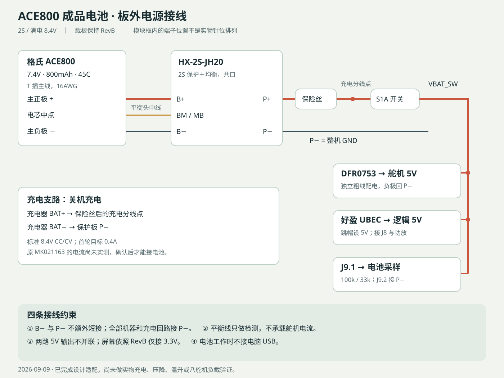

# ACE800＋HX-2S-JH20：板外接线

先在台面组装并测量，再装进外壳。所有接线、焊接和改插头都在电池拔下时完成；保留电池原T插，制作机器端配对线。屏幕和MG90S不能直连7.4V电池。

## 逐线连接表

| 起点 | 终点 | 用途 |
|---|---|---|
| 电池T插主正极 | BMS B+ | 主电流，16/18AWG短线 |
| 电池T插主负极 | BMS B− | 主电流，16/18AWG短线 |
| 三线平衡头中间电芯节点 | BMS BM（手册称MB） | 单节检测/均衡；万用表确认，不只看线色 |
| BMS P+ | 既有保险丝 → 受保护正极分线点 | 充放电共用正极 |
| 受保护正极分线点 | S1A总开关 → 两路降压输入正极 | 关机切断工作负载 |
| 总开关后VBAT_SW | 载板J9.1 | 仅电池电压采样 |
| BMS P− | 两路降压输入负极、整机GND、J9.2 | 全机回路，禁止改接B− |
| 已确认8.4V/0.4A CC/CV充电输出正极 | 受保护正极分线点 | 总开关前，经过保险丝 |
| 充电输出负极 | BMS P− | 共口充电；不接B− |
| DFR0753 5V/GND输出 | 舵机外置配电 | 共地；不能将舵机总电流送过PCA模块 |
| 好盈UBEC 5V/GND输出 | 载板J8.1/.2和功放供电分支 | 跳帽必须5V；不并联另一路5V |

平衡头两端线不用来承担主电流，备用线端逐根绝缘。BM处对B−应约为一节电压，B+对B−为两节总电压。接板顺序优先按随货说明；没有不同要求时，断开负载/充电器，先B−、再BM、最后B+。拆卸反序；双连接器要做标记，避免只拔主T插而让BM长期单独连接。

**B−是电池原始负极，P−是受保护的整机地，两者不能额外短接。** 示波器地夹、USB及外部电源也可能跨接保护回路；首次USB烧录拔出主控单独进行。电池运行时不接电脑USB，不把可调电源与降压输出并联。

## 充电

保留机身原Type-C位置与TELESKY MK021163安装空间，但目前还没有实测其输出恒流值。先在电池模拟负载下确认或修改为0.4A、8.4V CC/CV，再接电池。不能给“保护板”输入普通8.4V电压源就当成已具备完整自动充电管理；保护板不负责恒流恒压充电与正常终止。

手册“充电电压8.4–9V”不改变本电池的满充限制，本设计只用8.4V。保护阈值4.25V/节不应当作为日常充电目标。首版关机充电。

## 首轮验证

1. 检查电池外观、单节和总电压、T插极性、BM针序；完成绝缘后确认P+/P−正常。保险丝规格沿用既有设计，增加负载前检查线束和保险丝匹配。
2. 不接屏幕/主控/舵机，分别确认逻辑5V、舵机5V；屏幕使用经验证的3.3V方案。
3. 先单独主控和屏幕，再接现有一个MG90S。记录总输入电流、保护板P+/P−压降、两路5V压降及温升。
4. 用电池运行前安排有人监看电压，先以7.0V总电压停止动作并手动关机；逐节电压异常、保护动作或明显压降时提前停止。开发测试固件没有电池采样功能。
5. 后续按1→2→4→8舵机增加，检查启动、受力动作以及Wi-Fi/音频并发。45C标称、模块10A上限和空载正常均不能代替这一项。

如保护板在所需负载下压降/温升不合适，更换板外保护模块即可；不需要换掉本轮选中的2S电池或重画逻辑载板。
