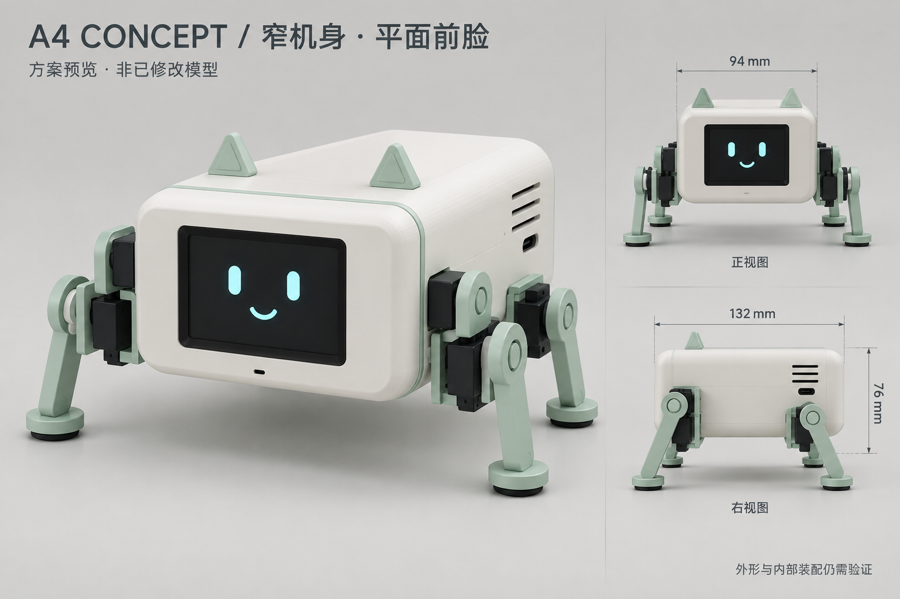

# A4 窄机身与平面前脸 · 概念设计

2026-09-13。阶段：待评审的外观与结构布置方案；未修改任何 Blender、STL、PCB 或固件。本文的新尺寸是设计目标，未做实体干涉、运动或装配验证。

用户已确认：按整个横放屏幕模组的外宽，左右各加约 10 mm，机身目标宽度 92–95 mm；屏幕不再深陷在前盖内。推荐取 94 mm。

效果图由内置 imagegen 根据旧 A3 参考图生成，用来评审外观，不是 Blender 修改后的截图，也不是按比例工程图。端口、关节和尺寸线的精确位置以之后建模结果为准。

## 1. 推荐外形

采用 94 mm 宽的圆角长方体机身，前面为横屏表情，机身前后略长。奶油白外壳、薄荷绿细边和腿架、黑色屏窗、青色表情，延续原有小猫造型。顶部两只小耳朵只作可拆装饰。

屏窗外表面与前面板基本齐平；用可拆压框和薄软垫从背面固定屏幕模组。保护窗可略低于周围外壳 0.3–0.5 mm，防止倒放时直接刮屏。透明保护片和下面液晶的间隔由实际模组厚度决定，目标不再出现原来约 20.8 mm 的深井。

正面按实际亮屏区域居中，不按模组排针或 PCB 外框强行居中。四角大螺丝移至底部或后部检修面。麦克风开口放在下方边框，不添加旋钮、用户按键或触摸功能。

## 2. 尺寸目标与已知约束

| 项目 | 本次设计目标或依据 |
|---|---|
| 外壳宽 × 深 × 高 | **94 × 132 × 76 mm**；不含脚、耳朵、外露螺丝与插头 |
| 允许深度细调 | 约 130–135 mm，根据插头和线束验证收敛 |
| 屏幕模组横放参考外形 | 约 72.26 × 43.00 mm，规格表厚度 3.7 mm；不含排针、线束接头 |
| 模组初步空间预留 | 74 × 45 × 5 mm，后方另留约 8–12 mm 接头/弯线空间；不能作为已核实装配尺寸 |
| 实际亮屏区域横放参考 | 约 50 × 38 mm；规格书不同图表存在小幅差异 |
| 面板黑色保护窗/装饰边目标 | 约 64 × 48 mm，内部透光开口最终依实物有效区确定 |
| 模组左右余量 | 按 72.26 mm 居中约 10.87 mm/侧；为亮屏居中可做少量左右调整 |
| 新主板 | Integrated V1.2，110 × 75 × 1.6 mm，已取消 EC11 |
| 壳壁初步值 | 2.4 mm，转角约 R8–R10；承重底盘与腿座另设加强筋 |
| 机身离地目标 | 约 30–40 mm，随站姿变化 |
| 含腿站立总宽目标 | 约 160–175 mm，需重新设计腿座后验证；不是 94 mm |
| 含耳站立总高目标 | 约 116–128 mm，随站姿变化 |

屏幕规格表写 43.00×72.26 mm、有效区 37.72×49.96 mm；商品说明为视窗 38.12×50.36 mm，机械图还有 VA/AA 和型号标题差异。本轮用这些数值建立空间概念，孔距、开窗和压框尺寸等取得实物或供应商更正图后再定。

## 3. 主板怎样放进去

主板在水平面内转 90°：**75 mm 沿机身左右，110 mm 沿机身前后**。这一安排满足已选 94 mm 壳宽，不需要为了外壳宽度再重画 PCB。

按 2.4 mm 两侧壁计算，壳体内净宽约 89.2 mm，75 mm 主板两侧合计余量约 14.2 mm，即各约 7.1 mm。这是直边处的粗略空间计算，不包括加强筋、线束、转角与插头，也不表示所有模块已装配通过。

132 mm 外深扣两端壁约剩 127.2 mm；110 mm 主板前后合计余量约 17.2 mm。屏幕支架、侧向插头和顶部零件采用分层与错位布置。若详细装配需要增加深度，优先在 130–135 mm 范围调整，保持已确认的 94 mm 宽度。

推荐让 J3 屏幕接口一端朝前，缩短屏幕线束；充电 USB-C 预留在侧后方并对准实际板端接口。开发板下载 USB 单独留检修通道，不能把两个 USB 的用途混为一谈。效果图上的小接口仅示意位置，不据此确定开孔。

## 4. 内部层次与维护

从前往后：前面板/屏幕 → 主板及开发板上层空间 → 后部扬声器、开关和检修区。

从下往上：承重底盘 → 电池与分区安装的小模块 → 绝缘支撑与主板 → 开发板/连接器/线束上方余量 → 可拆上壳。

- **电池**：沿用已选 ACE800 的供应商参考 60×32×16 mm，长边沿前后方向，放在底部中央区域，给软垫、束带、T 插和均衡线留空间。不能用硬壳挤压软包。旧 A3 的 75×40×20 mm 占位不再沿用。
- **两路降压**：仍是本版的板外模块，在底层剩余区域分舱固定，避开电池和麦克风。DFR0753 的实际包络与接线还需核对，不能因为电路集成就删掉它的空间。
- **主板**：使用独立可拆托架，通过现有四个安装孔固定；下方留焊脚净空与绝缘间隔，不让螺钉触碰电池。
- **开发板**：上层保持插拔与 USB 插线空间；天线一端靠塑料外壳，附近避开电池、金属支架与密集线束。
- **声音**：麦克风靠前下方开口，后上部装喇叭和功放；以短导声路径、固定与隔振安排减少机械噪声，效果需要实测。
- **散热**：后上侧设小条缝，底部配进气缝；电源元件周围保持空隙。外观上避免整侧大面积开窗。
- **拆装**：底盘承受腿部载荷，上壳和后盖用于维护；拆上壳能到主板、端子和模块，电池舱可独立打开。前屏组件检修才需要拆前面板。

## 5. 四条腿要一起收拢

保留四腿、每腿两个 MG90S 的路线，不增加电机数量。重排髋、膝舵机，让髋座位于机身下侧四角，膝舵机尽量向内安装，连杆以向下延伸为主；保持两关节在前后摆动平面内的运动关系。

旧 A3 腿部的外伸不能直接按机身缩小比例复用：旧源文件中足端中心约在左右 ±114.9 mm。仅将 124 mm 机身缩为 94 mm 并把旧腿各平移 15 mm，足端中心仍约在 ±99.9 mm，整体宽度仍超过 210 mm。因此本方案把**腿座与上腿连接方式**列为后续重新建模项目。

160–175 mm 的站姿总宽是收拢目标，不是已验证尺寸。详细设计要检查舵盘螺丝可达性、膝部电机与壳底/电池的间隙、前后腿互碰、弯线余量、足底支撑范围和单腿负载。不会把概念图外观视为步态验证结果。

## 6. 为什么推荐这一版

| 方向 | 特点 | 取舍 |
|---|---|---|
| **A：94 mm 等宽长机身，主板水平纵放** | 本方案，前脸与机身同宽、屏幕近表面、低位电池 | 推荐；可沿用 V1.2 PCB，深度约 132 mm |
| B：94 mm 窄前脸，后半部加宽 | 前面紧凑，内部布局余量更充足 | 整个外壳不能保持 94 mm，较不符合本次要求 |
| C：更短的 94 mm 机身 | 外观更像小方块 | 需先缩小或拆分当前 110×75 mm 主板，超出本轮纯模型方案范围 |

旧 A3 外壳参考 124×116.8×76 mm。本方案宽度减少约 30 mm；为容纳新集成主板，前后深度目标增加约 15 mm。取消深前盖解决的是屏幕表面关系，并不能单独决定整机深度。

## 7. 本轮交付与下一次建模边界

本轮只新增这份设计方案和概念效果图，所有既有模型、STL、PCB 和固件保持原文件。

本方案确定的方向：94 mm 外壳宽度、平面前脸、横屏、四足、小猫配色、主板纵放与低位电池。132 mm 深度、76 mm 高度、腿部总宽、开孔和内部支架均需在用户确认方向后的建模阶段收敛。第一步应建立真实模块包络和接口空间，再做壳体与单腿机构，最后装配四腿并检查运动。

## 依据

- 用户 2026-09-13 对 92–95 mm 模组基准宽度的确认。
- HS24S010B / C5329587 规格书的规格表与机械图；尺寸差异已在本文保留。
- `../structure-a3/reports/assembly-parameters.json`、原 A3 效果图及腿部构建脚本。
- `../../pcb-design/integrated-v1/final-no-encoder-2026-09-12/装配与接线说明.md` 与器件坐标表。
- `../../hardware-selection/battery-stock-2026-09-09/selection.json`；仅用供应商标称电池包络，不推断已收货或实测。

图像生成说明：使用内置 imagegen，旧 A3 斜视图仅作配色与四足形态参考。提示词核心为 94×132×76 mm 窄机身、平面前窗、实际约 50×38 mm 亮屏区、奶油白/薄荷绿、四腿八舵机向下收拢、正面与侧面辅助视图，并明确标注概念方案与装配待验证。
