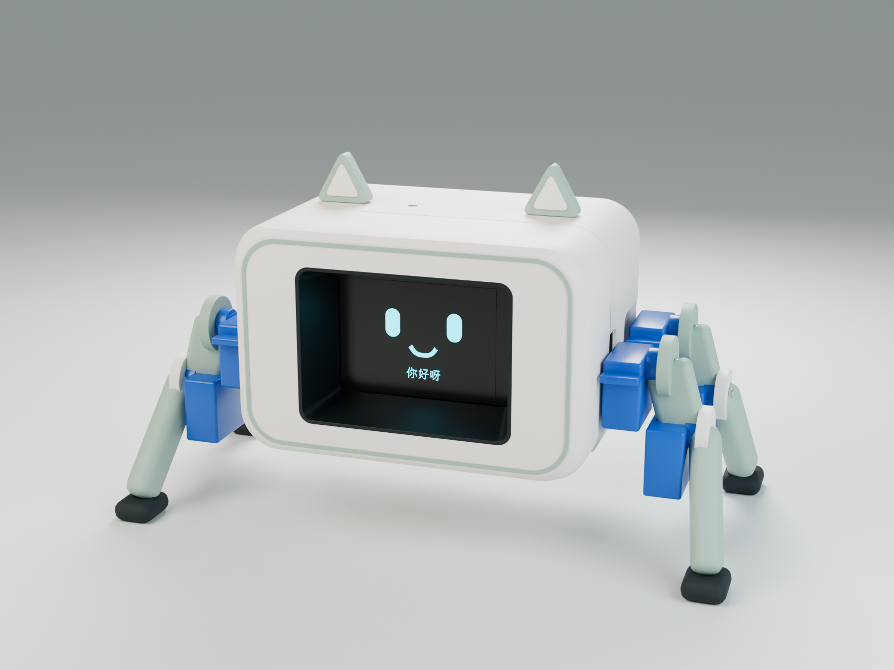

# 奶油薄荷 · Blender 总装 V1

日期：2026-09-07。状态：第一阶段外观、比例、分件和空间占位模型。已选配色为 **A 奶油薄荷**，屏幕沿用用户已选的 **途格斯 2.4 英寸 TFT + EC11**。

本包用于一起评审外观和内部布局，包含真实可编辑的 Blender 几何与渲染。**还不是可交商家直接打印的生产文件**：屏幕细节尺寸、舵机与其他电子件型号未实测/冻结，紧固、承载连接和运动范围尚待设计。这里的“分件”是编辑与装配组织，不代表已经确定了制造件 BOM。

## 打开与浏览

- 用 Blender 打开 `desktop-assistant-assembly-v1.blend`。本次使用 Blender 5.2.1 LTS。默认处于整机装配状态和主相机视角，使用毫米显示单位。
- 直接看渲染：打开 [图片目录](renders/)；[所有视图索引](gallery.html) 可以本地浏览。
- 查看拆开状态：把时间轴当前帧设为下表数值。中间帧的插值只用于展示，不是经过验证的装配或步态动作。
- 在 Outliner 的 `06_ASSEMBLY_CONTROLS` 中选择 `ASSEMBLY_…` 空对象可以移动整个总成；具体几何则在壳体、腿、显示模块、电子占位等集合中单独编辑。默认隐藏视图叠加层，可点击视口右上角的叠加层按钮重新显示控制点；无需修改模型。
- 主相机以外，可在 Outliner 的 `90_STUDIO` 中找到 `CAM_01` 至 `CAM_08`。材质、灯光和所用中文字体保存在文件内，表情由原生几何/文字对象组成。

| 时间轴帧 | 状态 | 相关总成 |
| --- | --- | --- |
| 1 | 整机装配 | 全部回到设计位置 |
| 40 | 前盖拆开示意 | 前盖、装饰圈、遮光井向前移动 85 mm |
| 70 | 底盖拆开示意 | 底盖向下移动 29 mm |
| 100 | 爆炸示意 | 主壳、前盖、底盖、显示、电子件、耳饰与四腿分开 |

## 本版完成了什么

奶油白主壳与前盖、薄荷绿细边/耳框/腿部、奶白耳内片和黑色脚垫已经建立材质。表面呈低光泽磨砂方向，微纹理由渲染材质表达；没有把大量细纹直接刻进打印网格。颜色代码是视觉目标，材料牌号、样板色差、层纹和后处理另行确认。

主壳、前盖、底盖、屏幕支撑框、遮光井、电子托板、耳饰和四足从一开始分别建立。前盖定位柱、主壳接收结构、耳键、电子托板支柱已纳入对应几何。定位配合采用试验性间隙，最终螺钉/螺母、卡接或其他锁止尚未完成。

内部放入了 91×44 mm 标称屏幕 PCB，以及 LCD、EC11 旋钮、独立按键和接插件占位。主控、舵机驱动、功放、麦克风、扬声器、供电处理区采用明确的 `ENVELOPE` 占位；它们不是已采购型号，也不是可直接用的接线设计。

**腿部连接仍待工程设计。** 两个关节控制点用于姿态编辑，不含舵机极限、步态或动力学。`P010` 连接区域已标作隐藏的线框占位，不能从其名称推断为完成的舵机支架。腿组向左右各外移 13 mm，用来避开偏置屏幕 PCB；这一修改没有增加机身宽度，但增加了站姿足端跨度。后续确定真实舵机和安装方向后会重新优化。

## 当前尺寸与依据

尺寸单位均为 mm。除明确注明的商品标称值外，均为本次设计假设。

| 项目 | 本版数值 | 依据与限制 |
| --- | --- | --- |
| 主体外宽 | 118 | 沿用居中比例的初始假设，未冻结 |
| 主体前后深度 | 约 84.6，含细边 | 保留完整旋钮的包络；不含腿 |
| 主体高度 | 76 | 不含耳和腿，底盖有约 0.3 的额外突出 |
| 当前整机可见包络 | 208 × 106 × 122.5 | 含四腿、脚垫、耳；仅当前静态姿势 |
| 屏幕 PCB | 91 × 44；厚度暂设 1.6 | 长宽为商品标称，厚度待实测 |
| PCB 四孔 | Ø3；84.5 × 37.5 孔距 | 商品标称，实物复核后用于试配件 |
| PCB 水平偏置 | 向右 10.5 | 使本版 LCD 中心与机身中心重合 |
| LCD 外框占位 | 59 × 41.5 | 非确认有效区；商品图写 59 × 42.5，须核对口径 |
| 有效显示区占位 | 48.768 × 36.576 | 由标称 2.4 英寸与 4:3 推算，待实测 |
| 前盖开口 | 70 × 51 | 为凹进屏幕留视线空间，尚非制造开窗 |
| 屏幕玻璃相对前盖 | 后退约 20.8 | 完整 EC11 藏在同一盖内的结果 |
| EC11 向前突出 | 约 21 | 仅建模假设；商品所写 15 mm 轴长不是总高度 |
| 基本壁厚设计值 | 2.4 | 转角、孔边、加强区需逐处检查 |
| 前盖定位径向间隙 | 0.2 | 试验值，未按打印机/材料验证 |

屏幕正对机身中心；整块 PCB 向右偏置。这样保留了商品原有的右侧旋钮和按键。当前 PCB 右边缘距壳体内壁的名义余量仅约 **0.6 mm**，支撑框更紧，必须依实测再决定是否增加 1～数 mm 外宽。不能凭此模型承诺收到商品后直接装入。

前盖盖住旋钮后，LCD 玻璃明显位于前盖后方。渲染忠实保留了这一深度，没有在最前面另放一块假显示面。斜视会受遮光井限制；待实测旋钮帽、轴、LCD 与 PCB 高差，再评估能否在保留该模块的情况下减少凹进。旋钮/按键需拆盖后操作，暂未增加外部传动或按键机构。

## 几何和文件组织

| 名称前缀/集合 | 含义 |
| --- | --- |
| P001～P009 | 壳体、盖、装饰、遮光井、托板、屏幕支架、耳饰等候选结构 |
| P010 | 未完成的舵机连接占位，已隐藏渲染 |
| P011～P014 | 腿与关节外观候选，舵盘配合和承载尚未设计 |
| D001～D013 | 用户已选显示模块的外形模型，内部细节含假设 |
| E001～E007、ENVELOPE | 未选定电子件的空间占位 |
| S_…、H_…、F_… | 舵机、紧固件、软脚垫示意 |
| ASSEMBLY_…、J_… | 总成移动与关节姿态编辑控制点 |

`reports/component-list.csv` 是对象目录，不是采购 BOM 或打印报价数量。定位柱/耳键等已合入对应大件，但装饰细边是否独立打印、垫柱是否外购、腿部边界等仍可变。本轮不输出 STL、3MF、STEP 或 G-code，以免把空间占位误作制造文件。

## 文件清单

- `desktop-assistant-assembly-v1.blend`：完整总装、独立对象、材质、灯光、相机和拆开姿态。
- `renders/`：八张 1800×1350 实际 Blender 渲染。
- `reference/`：已选配色图与用户商品规格图；供对照，非工程尺寸图。
- `reports/measurement-checklist.csv`：需要补齐的测量项目。
- `reports/design-parameters.json`：本次主要设计参数。
- `reports/component-list.csv`、`object-inventory.json`：对象、尺寸、类别和单体网格记录。
- `reports/validation-report.md`、`reopen-verification.json`：保存后重开验证范围与结果。
- `reports/independent-review.md`：初审、修订复核历史；以末尾最新结论为准。
- `scripts/build_assembly.py`、`verify_saved_assembly.py`：重建与验证脚本。

重建脚本会覆盖本目录的同名 `.blend` 和渲染；手动编辑后应先“另存为”新版本。脚本数值化记录造型和位置，但仍有固定坐标，不是全约束参数化 CAD。需要精密孔位关联与 STEP 交换时，可在后续为结构件建立 CAD 源文件。

## 接下来的打印准备

先按照测量表补齐屏幕的玻璃/可视区、偏置、孔距、旋钮与背面高度、排针/线缆空间，再确定舵机及主控/音频/供电件。接着完善载荷连接、孔位、公差和工具进入空间，优先做屏幕样框、前盖连接样件与单腿支架试配。通过毫米导出、网格、壁厚与切片检查后，再发布整套商家打印包。

显示模块已选定，但整机含定制 PCB 的 BOM、PCB 布局、供电与语音电气方案、代码均未在本阶段完成。
