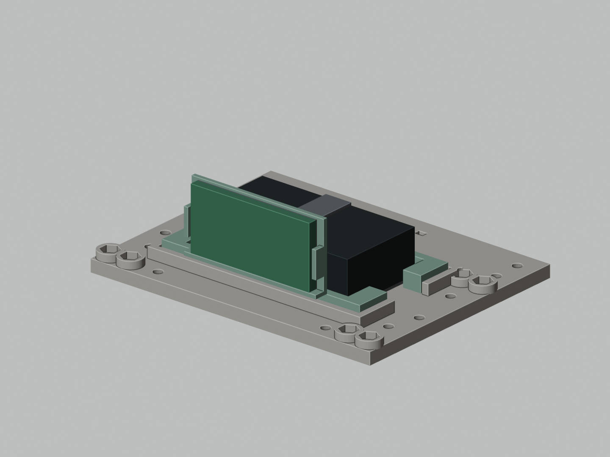

# A3：ACE800成品电池适配件

按格氏ACE800的页面尺寸60×32×16mm及HX-2S-JH20的46.7×23×3.15mm设计。原A3的30件保持原文件，新增以下两件，每件1个。

| 编号 | 文件 | 用途 |
|---|---|---|
| R21 | [定位垫框](stl/R21__ACE800__mm.stl) | 78×42mm外形放入原79×44mm电池槽；64×36mm内口配约2mm侧软垫 |
| R22 | [保护板托架](stl/R22__ACE800__mm.stl) | 两脚定位到R21，将保护板竖直固定在电池前侧，避开原PCB支架 |

[Blender适配副本](DesktopAssistant-A3-ACE800.blend)保留原场景，新增`20_A3_ACE800_ASSEMBLY`总装和`21_ACE800_POWER_BAY_DETAIL`局部场景。模型中的电池、保护板、软垫和束带只是购买件的包络参考，不能打印。

安装：1mm底部EVA；电池侧面约2mm软垫，不硬夹软包；原10mm束带从R21下方通道穿过并固定电池。R22两脚定位后，用少量可拆除、电子器件适用的中性RTV固定脚位，待固化后检查是否松动；不能只靠松配合插脚承受行走振动。保护板底部放0.5mm电气绝缘垫，以适用电子器件的绝缘固定材料固定，焊点逐一绝缘，勿覆盖需散热的器件。

保护板与屏幕支架后表面名义间隙1.65mm，与屏幕PCB背面7.25mm；不包含焊脚、线束、热缩材料和打印误差。垫框底部预留0.1mm安装余量，可用薄绝缘胶带垫平。插头和电源线沿原+X出线口引至机身后部，留出拆卸长度。原电池75×40×20mm占位已从新场景中移除。

STL单位mm，单件原点放在底面Z=0。R21底面朝下；R22建议在切片器中让竖直背板的大平面朝下，底托与定位脚朝上。建议PETG、0.2mm层高、4圈壁；孔槽与薄桥需检查切片，先试装这两件。托架是常温结构固定件，不是电池防火壳。

[几何复核](reports/fit-check.json)包含闭合性、连通性、体积和新增实体对原A3结构的静态交集检查。它不代替实物试装、胶粘牢度、线束运动、散热与八舵机负载验证。原30件STL、原A3 Blender与RevB Gerber均未改写。
