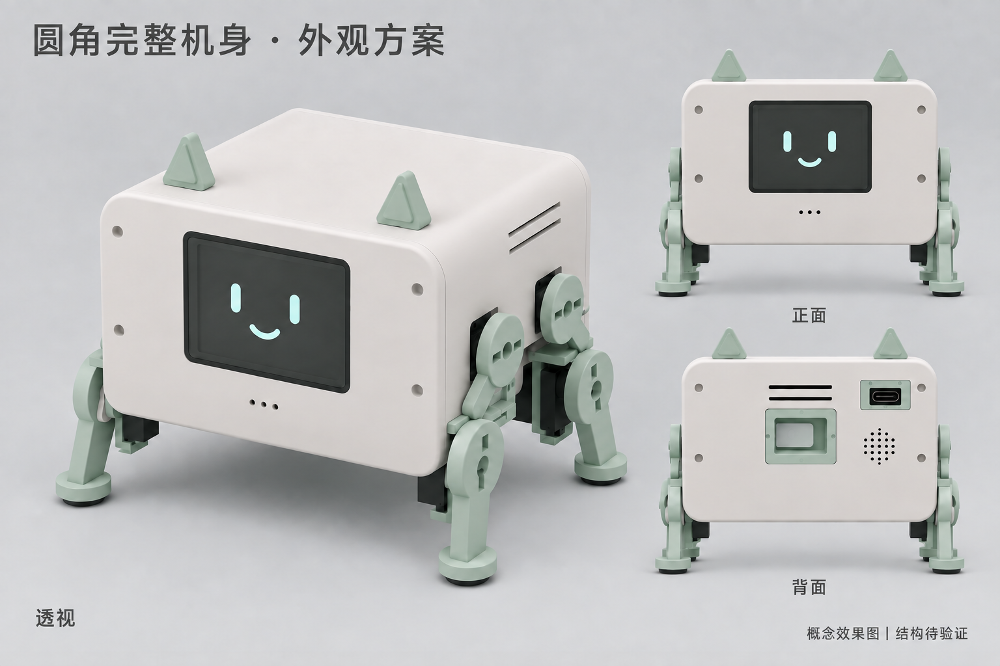

# 完整圆角机身与腿部收拢方案

整理日期：2026-09-15。状态：外观提案，尚未实施到 Blender 或 STL。

本方案回应用户要求：前后面板底部采用相同的完整圆角，去掉向内凹陷的避让口；延续机身适度加宽、前后缩短、腿部向腹部收拢的方向。

效果图使用内置 imagegen，以实际 A5 的透视、正面、背面、俯视渲染为参考生成。它用于判断外观，不是已修改的 Blender 模型渲染；图中的关节、开关和接口细节不构成精确装配尺寸。

## 推荐方案

采用完整圆角盒体，前后盖使用同一套外轮廓参数。底部以一条较长的连续直边连接左右外圆角，取消内凹弧口、阶梯和中间下垂的窄面板。下圆角以 R10–12 mm 为初步建模范围，前后保持一致，并与上圆角协调。

先沿用 A5 的机身体积和电子部件布局，通过重新布置腿架与关节来满足外轮廓。前腿向后、后腿向前移，把膝关节活动范围拉回前后盖之间；调整上腿连杆偏置、舵机支架和腹部开口。关节必要开口集中在侧面及腹部，前后盖轮廓保持完整。

左右脚距需要在收拢外观与支撑稳定性之间取舍，不能为了正面遮住舵机而无限向内收脚，也不能靠缩小舵机模型制造虚假的空间余量。

## 尺寸依据与目标

基线取自 `../structure-a5/reports/dimensions.json`，此次重新读取了该报告，未重新计算 A5 网格。

| 项目 | A5 报告中的尺寸 | 本方案目标 |
|---|---:|---|
| 机身左右宽 × 前后深 × 高 | 124 × 112 × 76 mm | 首轮保持这个尺寸进行腿位验证 |
| 当前中立站姿，含耳朵和脚垫 | 162.9 × 116.5 × 122.46 mm | 作为比例参考；新站姿尺寸需由改后的模型重新计算 |
| PCB | 110 × 75 × 1.6 mm | 保持用户最新版主板 |
| PCB 安装孔距 | 102 × 67 mm | 保持 |
| 前后盖外圆角 | 当前含不一致的下部避让口 | 同一轮廓，初试 R10–12 mm |

屏幕继续采用 HS24S010B 横屏、接近齐平安装，效果图沿用 A5 的屏幕占比。象牙白机身、薄荷绿色耳朵及腿件沿用现有模型。

## 腿部调整如何落地

1. 先独立建立完整前后盖，锁定其外轮廓，检查正面、背面和侧面比例。
2. 以 A5 腿位为起点，在真实 MG90S 本体、舵盘及支架尺寸下，试验前后膝关节各向腹部中间移动约 8–10 mm。这是搜索初值，不是已验证的安装位置。
3. 同步调整上腿连杆和固定座，检查与地板、电池托盘、降压模块及喇叭的空间关系；根据结果调整腹部内部结构。
4. 如仍无法容纳，重新评估关节高度、连杆偏置和内部托架；需要改变机身尺寸时应明确展示尺寸与比例变化。
5. 验证连续运动扫掠、四腿组合姿态、线束活动余量和支撑范围。A5 的旧姿态检查不能直接沿用为新方案的通过结果。

## USB-C 与总电源开关

- 充电入口保留对准 PCB J6。A5 主板旋转后接口朝向后盖；效果图背视图右上方是该充电入口。
- 结构设计以 A5 的 17 × 11 mm 可拆卸入口孔板作为初始参考。保持插头护套插入空间，不按效果图中的金属接口轮廓直接缩孔。需核对实际 USB 线缆和最终连接器。
- 外接 5V 通过 J6 和 IP2326 给 2S 锂电池充电的电路方向沿用。开孔不代表充电通路已启用或完成实测。
- 总开关功能保留。效果图用凹仓内的短拨片表达较整洁的外观，不再画外伸长杆；这不是已选定的开关型号，也不表示已替换原有候选件。后续须核对直流电流额定值、安装深度和可操作性。
- 保留后盖喇叭孔及通风孔；不增加 EC11 或正面日常按钮。

## 取舍

| 路径 | 优点 | 代价 | 结论 |
|---|---|---|---|
| 完整外壳，重新布置腿架与关节 | 保持紧凑比例，直接解决前后凹口问题 | 需要重新设计部分腿件及验证运动 | 推荐 |
| 加长或明显抬高机身，给原腿位腾空间 | 内部避让相对直接 | 可能重新出现机身偏长或重心偏高的问题 | 仅作为空间不足时的备选 |
| 只给凹口加装饰盖 | 外观修改范围小 | 盖板会侵入原运动空间，不能消除结构冲突 | 不采用 |

## 当前交付与后续验证

本次只保存方案、概念效果图及生成说明。A5 `.blend`、STL、当前结构版本指针、PCB 和 BOM 未因本方案改动。

实施时先完成轮廓与单腿空间验证，再制作全部零件；随后检查 USB 插拔、开关操作、散热和拆装路径，重新导出及审核模型。CAD 结果仍需实物打印、部件试装、承重与步态验证。
