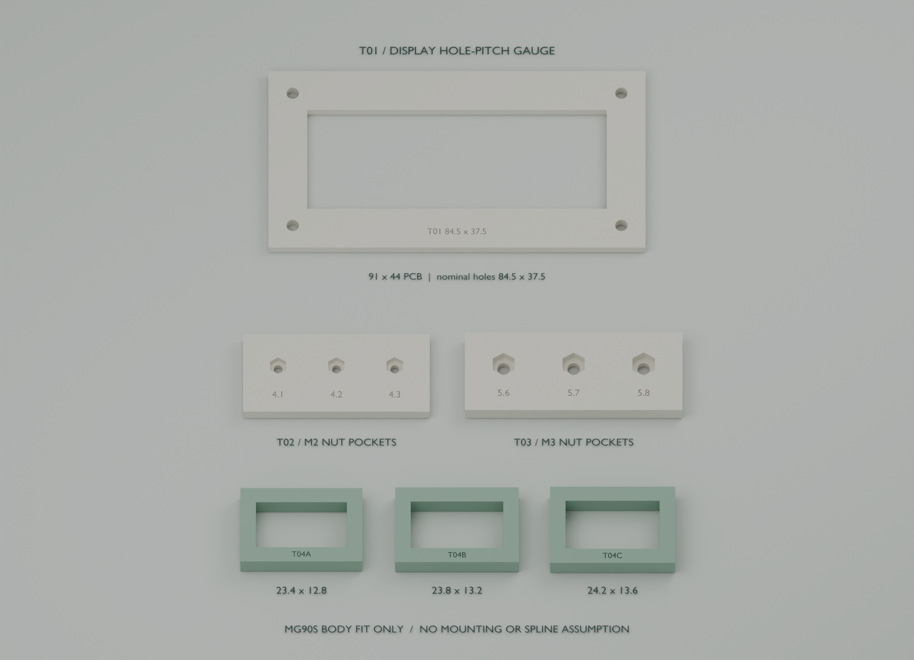

# 结构设计 V2：首轮试配件

2026-09-08。已实际建立可编辑 Blender 文件和 **6 个按毫米导出的试配 STL**。本轮用于校验屏幕孔距、M2/M3 螺母槽间隙和 MG90S 机壳开口；不是整机外壳与四腿的最终打印包。尚未交商家打印或完成切片、实物试配。

## 文件与打开方式

- `desktop-assistant-print-v2.blend`：默认打开新试配件场景 `02_PRINT_V2__FIT_COUPONS_ONLY`。原用户总装完整保留在 `01_ASSEMBLY_AND_DISASSEMBLY` 场景，可在 Blender 顶部切换。
- `stl/`：仅 6 个试配件，无电子模块、旧腿部占位体或完整外壳。
- `parameters.json`：本轮关键尺寸，单位 mm。改参数后用 `scripts/build_print_v2.py` 重建本目录，不覆盖 V1。
- `reports/`：源模型尺寸清点、STL 独立检查、保存重开记录。
- `assembly-parts-plan.md`：整套分件、紧固、工具空间和待补尺寸。
- `pcb-interface-proposal.md`：已传递给 PCB 任务的板框空间提案。

已从用户保存的真实 `assembly-v1/desktop-assistant-assembly-v1.blend` 建立 `source/desktop-assistant-user-saved-v1.blend` 字节一致副本。原文件 SHA-256：`df56e4b399b337fb912708011ed11bd848c1d052193cc0339aefa19d34459c0a`。新文件保留源场景全部 196 个对象，源网格和世界变换指纹在保存、重开后相同；没有重跑 V1 生成器。

## 本轮 6 件

| 编号 | 用途 | 实际导出外形，mm | 数量 |
| --- | --- | --- | --- |
| T01 | 屏幕四孔孔距试配框 | 97 × 50 × 3 | 1 |
| T02 | M2 六角螺母三档间隙片 | 48 × 22 × 4 | 1 |
| T03 | M3 六角螺母三档间隙片 | 56 × 22 × 5 | 1 |
| T04A | MG90S 机壳开口规 A | 31.4 × 20.8 × 6 | 1 |
| T04B | MG90S 机壳开口规 B | 31.8 × 21.2 × 6 | 1 |
| T04C | MG90S 机壳开口规 C | 32.2 × 21.6 × 6 | 1 |

T01 四孔中心距为商品标称 **84.5 × 37.5**，试件通孔 Ø3.2。拿完整屏幕板从背面核对四孔即可，不需要先拆焊旋钮/按键。先悬空对孔，确认背面元件不被框压住，再用已有 M3 螺丝或尼龙垫柱轻定位；不能把框硬压在元件上。中央 77 × 28 开口仅是留空，不是有效显示区，也不是最终前盖窗口。该框比屏幕 PCB 大，属于桌面量规，不直接装入现有机壳。

T02 标记 4.1 / 4.2 / 4.3，表示六角槽的对边尺寸；槽深 2.1，螺孔 Ø2.3。T03 标记 5.6 / 5.7 / 5.8，槽深 2.9，螺孔 Ø3.3。用已采购的 M2 / M3 普通六角螺母从上方放入，记录能平放、可取出、拧螺丝不空转的最小一档。标称 M2 对边 4.0、M3 对边 5.5 是试验基准，需用实际螺母与所选打印工艺决定正式槽尺寸。这是开口螺母槽试片，不是已经验证防脱落的封闭螺母结构。

T04A/B/C 的内部开口分别为 **23.4 × 12.8、23.8 × 13.2、24.2 × 13.6**，周壁 4、高 6。用于到货后快速选机壳安装间隙；不能强行挤压舵机壳。数值来自通用外形假设，尚非所购批次实测。这些样规没有舵机耳孔、舵盘花键和转轴配合，不承担腿部载荷。

## 试印设置建议

所有 STL 已平放，底面 Z=0，导入切片软件时选择 **mm、100% 比例**。若软件显示 T01 宽度不是 97 mm，应先纠正单位。不要自动“适应打印机”缩放。

本轮先按 0.4 mm 喷嘴、0.2 mm 层高、4 道壁、上下 5 层、30% 填充作 PLA 或 PETG 尺寸试验；平面贴平台，孔槽朝上，几何无需支撑。材料和孔补偿应与后续正式结构试印一致。薄荷绿/奶油白只是对应外观方向，量规可用手边同工艺材料；STL 不带颜色。

独立重读 STL 已通过 6/6：单一连通封闭表面、边两侧方向一致、无重复或退化三角面、体积为正、毫米外形与清单误差小于 0.01 mm。新 `.blend` 已保存后重开通过。检查未覆盖全部可能自交、打印机工艺和实物配合；商家切片预览、孔补偿与实物试配仍需执行。试片成功也不等于整机承载和行走通过。

## 下一轮接着做

用户已授权把旋钮、独立按键设计到后面板，保留完整 91 × 44 屏幕 PCB，玻璃相对前盖内缩目标 0.5～1 mm；实际拆焊尚未实施。这会改变 V1 深前盖，本轮保留 V1 原貌供对照，没有把旧深盖改名为新制造件。

优先等待屏幕背面/玻璃/控件尺寸、同批 MG90S 孔位及舵盘、电池最终成品尺寸。PCB 先采用 80 × 32 载板提案，主控 USB 需侧向插拔空间；麦克风商品身份与尺寸仍在核对。下一轮据这些结果重做浅前盖、可拆后面板、底盘和单腿支架，再推进全套壳体和四腿，具体分件见 `assembly-parts-plan.md`。
