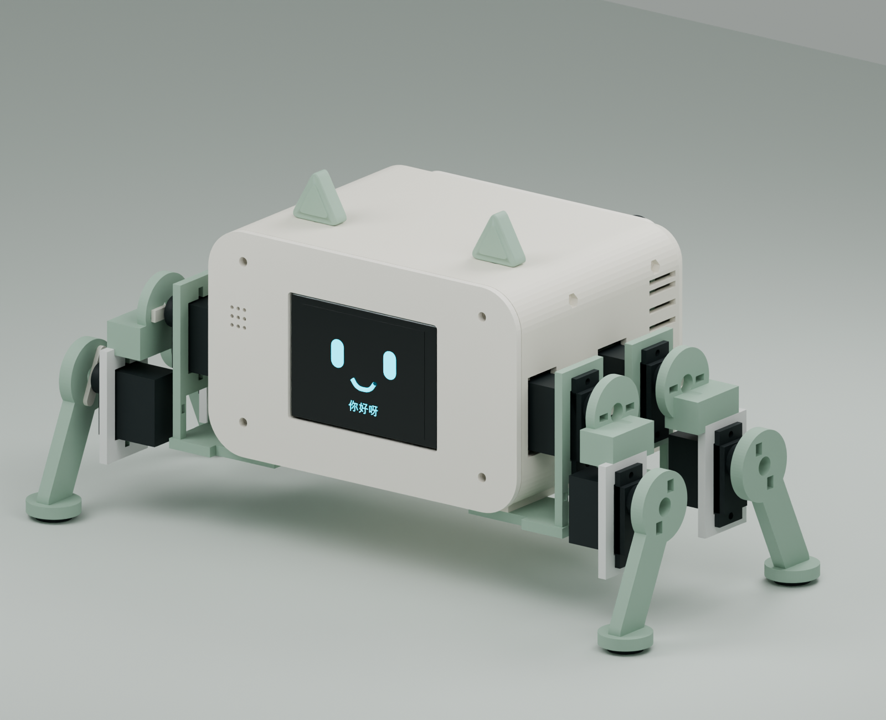
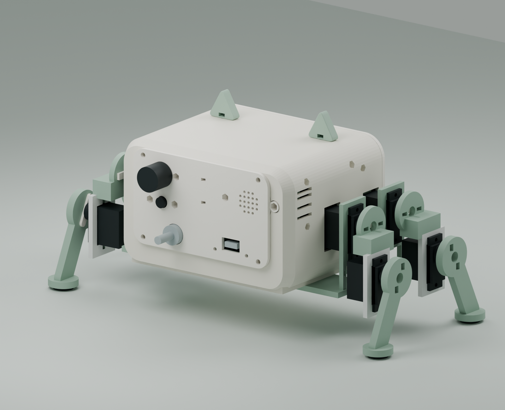
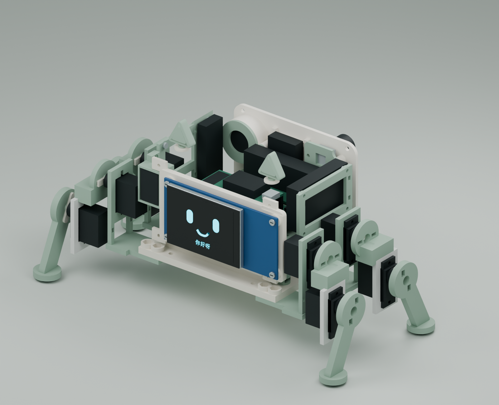
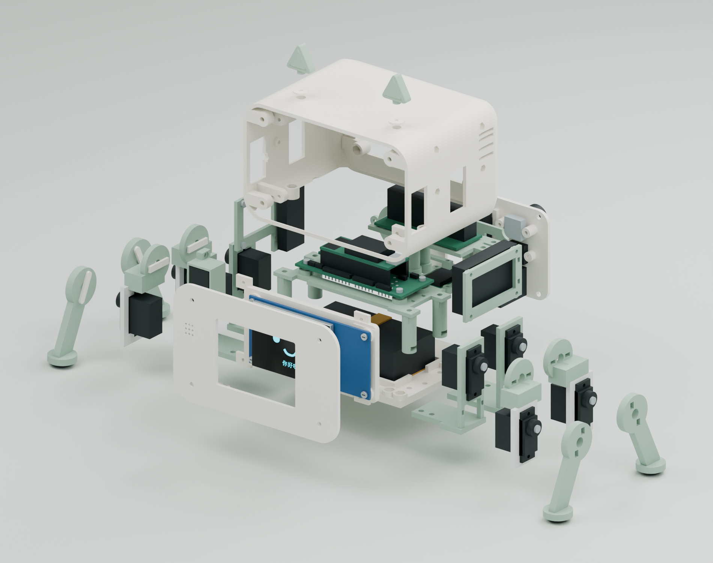
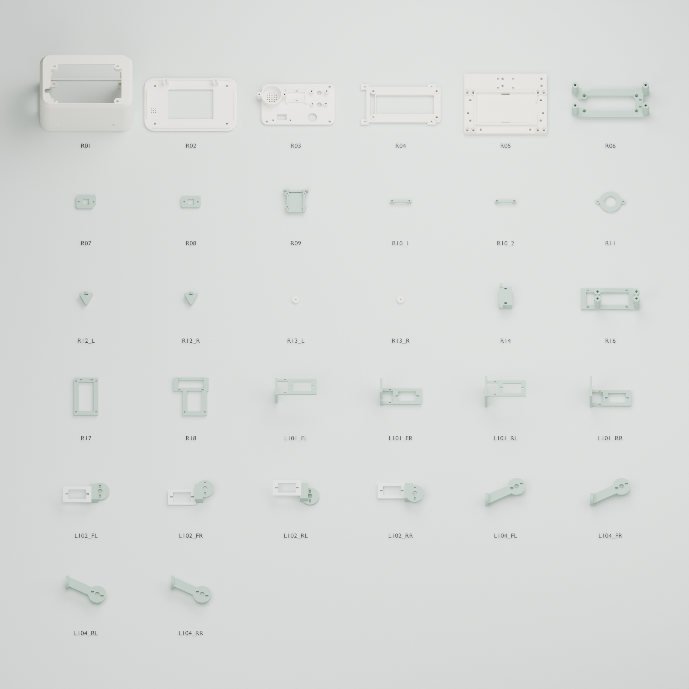

# Desktop Assistant — 整机结构 A2

**当前入口：DesktopAssistant-整机结构-A2.blend。32个独立STL在stl-complete/中，每个打印1件。**

本轮已完成主壳、前后盖、加强底盘、主控/屏幕支架、四条两关节腿、后控件和电源音频固定结构。电子件采用已选型号的资料尺寸或明确标记的预留包络，仍需拿实物试装。

Blender中保留三个当前视图：`10_A2_COMPLETE_ASSEMBLY`整机装配、`11_A2_EXPLODED_ASSEMBLY`爆炸关系、`12_A2_PRINT_PARTS_OVERVIEW`零件总览。旧用户场景也保留；当前打印只取stl-complete/。

- [零件清单](零件清单.md)：全部32件与导出尺寸。
- [装配与打印说明](装配与打印说明.md)：打印建议、装配顺序、采购差额及待测尺寸。
- [紧固件核对CSV](紧固件与辅料核对.csv)与[安装明细CSV](紧固件安装明细.csv)。
- [验证说明](验证说明.md)：网格、静态干涉、腿部抽样的实际检查范围。
- [参数记录](reports/assembly-parameters.json)：尺寸和坐标基准。

机身含前后盖约124×96.8×76mm（不含腿、耳朵、外伸旋钮）。屏幕91×44mm原板保留完整，EC11和独立按键后置；电池仍按75×40×20mm目标。主控PCB按原80×32mm板框和4孔安装，板底Z66。四处PCB固定改用小头M2，底盘固定仍为M3。

新增结构明确了紧固件数量：需核对M2×8、M2×10、M3×10、M3×12和增加的M2螺母；原V7采购表里的数量为设计前估数，未自动变更购物车。

重建脚本位于完整项目的structure-a2/scripts/，依赖原项目中的A1及原生PCB资料。独立交付ZIP不包含重建输入，但无需运行脚本即可编辑Blender和读取STL。几何和拓扑检查已完成；实际切片、实物适配、线束、承载、步态、温升与RF测试尚未完成。
