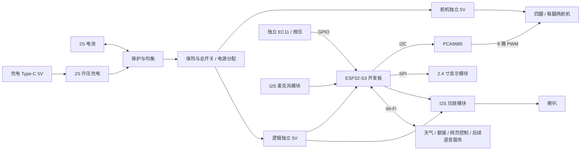

# 新版 PCB · 整体设计思路

> **2026-09-12 V1.2 无旋钮更新：** 五页原理图及 110×75 mm 双层 PCB 已完成，原理图/PCB 原生 DRC 严格通过。当前为 79 个器件、310 个引脚、59 个有连接网络；EC11 及三个上拉电阻、相关走线与定位孔均已移除。HS24S010B 使用单排 10PIN 屏幕接口，经主板 XH-10A 线束连接。准确工程、BOM、Gerber 与接线资料见 [V1.2 无旋钮交付](final-no-encoder-2026-09-12/README.md)。下文保留设计历史，其中旋钮、旧型号/针序、旧数量与“PCB 未完成”等描述均已被本次交付替代。

> 整理日期：2026-09-12。
> 对象：`DesktopAssistant_Integrated / integrated-v1`。依据现有项目文档与最后的 EDA 建板记录整理；本轮没有修改原理图、PCB 或固件。
> 本文说明架构、取舍与待核对项。功能框图是目标关系，不是已经逐针验证通过的接线图。

## 1. 这块板要解决什么问题

新版计划把桌面助手的充电、保护、两路供电、八路舵机配电和外设接口集中到一块主板，减少外置小板之间的飞线与插接点，让电气连接、安装和后续维护更明确。

产品目标延续：有显示屏、支持语音输入输出、四条腿可以行走。已有 ESP32 显示与联网程序继续复用。

整合后，整机仍由主板、电池、屏幕、喇叭、舵机以及若干可拆模块组成。主控开发板与部分功能模块保留，方便逐块测试、更换和调试。

## 2. 与 RevB 载板的区别

| 项目 | RevB 模块载板 | 新版 integrated-v1 |
|---|---|---|
| 核心职责 | 主控与外设的接口连接 | 接口连接 + 电池管理 + 供电与舵机配电 |
| 主控 | LCKFB-ESP32S3R8N8 开发板 | 继续复用开发板与两列 20P 插座 |
| 电池保护/均衡 | 板外现成模块 | 计划集成保护 IC、MOS 与均衡电路 |
| 充电 | 外置充电模块 | 计划板上 Type-C + 2S 升压充电电路 |
| 舵机控制 | 外部 PCA9685 模块，功率配电在板外 | PCA9685 裸芯片 + 8 个舵机接口 + 板上功率配电 |
| 电源 | 板外两路稳压供电 | 两路独立 5V，模块固定与连接纳入主板 |
| 屏幕 | TOUGLESY 屏幕、旋钮、独立按键一体板 | 无旋钮/按键的屏幕模块，EC11 独立布置 |
| 板框/工艺 | 80×32mm、2 层、1.6mm、1oz | 当前草案 110×75mm、2 层、1.6mm、2oz |
| 结构关系 | 对应 A3 模块结构基线 | 安装孔、支架、屏幕和控件位置需要重新适配 |
| 当前进度 | 已有经过检查的原生工程和 Gerber | 原理图已建，电气审查有缺口，PCB 未完成 |

新版板子更大，是因为它承担了原来由多个外置模块和线束完成的工作。减少零散模块后能否缩小整机，还需要三维装配验证，不能只看 PCB 面积。

## 3. 总体功能结构



框图中的“保护与均衡”是功能模块，包含电池端 B+/BM/B− 与受保护端 P+/P− 的区别；不是把保护 IC 直接串进主电流。现有设计采用低边保护 MOS，原始电池负极不能被整机地铜直接短接绕过保护。

## 4. 各个模块为什么这样做

### 4.1 主控：复用开发板，把主要精力放在整机连接

保留 LCKFB-ESP32S3R8N8，通过两列 1×20P 插座安装。USB 下载、复位、Flash、PSRAM、射频与基础稳压继续使用开发板已有电路。

这样可以延续目前跑通的显示、联网和网页控制固件，也便于在主板故障时把开发板取下单独测试。布局时仍需核对两列排针间距、插座高度、USB 插线空间与天线净空，不能仅按开发板外形画一个矩形。

主控主要负责显示、交互、网络、音频数据处理和运动指令；PCA9685 负责持续输出舵机 PWM。

### 4.2 电源：一块 2S 电池，分成舵机和逻辑两路 5V

电池选型沿用 ACE800，标称 7.4V、满电 8.4V。两路降压从受保护的电池输出取电：

| 电源域 | 主要负载 | 当前设计取值 |
|---|---|---|
| `+5V_SERVO` | 8 个舵机 | DFR0753，按舵机瞬态负载设计功率路径 |
| `+5V_LOGIC` | ESP32 开发板、MAX98357A 功放 | MP1584 模块候选，实际可用电流需按热设计和实测确认 |
| `+3V3` | 屏幕、PCA9685 逻辑、麦克风及信号上拉 | 当前草案从开发板 3.3V 取电，必须核算总负载与稳压余量 |

两路 5V 共用保护后的地参考，**输出正极不并联**。分两路稳压可减轻舵机动作对显示与主控的影响，但电池、地回流和功放的瞬态负载仍然需要一起检查。

屏幕和背光固定使用符合模块要求的 3.3V。若开发板 3.3V 的电流/温升余量不足，应增加独立稳压并明确电源选择，不能直接把两个 3.3V 输出并接。

电池电压经分压送 ADC，用于低电量提示和停止动作；软件低电量处理与电池硬件保护分工不同。

### 4.3 电池管理：充电、保护、均衡各司其职

- **充电**：Type-C 的 5V 经升压充电电路，对 2S 电池执行适配的 CC/CV 充电。Type-C 接口形状不代表具有 PD 协商；输入电流能力与 CC 接法需要核对。
- **保护**：检测单节过充/过放及过流等条件，通过 MOS 控制充放电路径。
- **均衡**：分别检测两节电芯，在满足条件时通过各自泄放支路减小电压差。需要 BM 中点连接与正确的 MOS 驱动。
- **保险与总开关**：限制故障后果，提供明确的整机负载断开方式。

首版延续“关机充电”目标。对应的正极支路关系应是：

```text
受保护电池正极 P+ ─ 保险 ─ 电源节点 ─ 总开关 ─ 两路降压与负载
                              ↑
Type-C 5V ─ 2S充电电路 ───────┘

充电器与整机负载回流接受保护负极 P−；原始 B− 不与 P− 直接短接。
```

**这是待核对并落实到原理图的目标关系。** 旧网络表把充电输出写到开关后的 `VBAT_SW`，与“关机可充电”不一致，必须先统一。现有方案也不能因此被描述为已支持边充边用、自动电源切换或完整电源路径管理。

开发板 USB 与外部逻辑 5V 同时接入的隔离/选择方式也需要明确，防止电源互相回灌。

### 4.4 舵机：控制信号集中，功率回路单独设计

使用 PCA9685 的 8 个 PWM 通道，对应四条腿、每腿两关节。芯片的逻辑供电与 I2C 上拉为 3.3V，OE 需要默认禁止输出，初始化完成后再使能。

每个舵机接口包含信号、5V 和地，明确标注腿位、关节和针序。舵机电流由 DFR0753 经主板功率配电送达，**不经过 PCA9685 芯片或 ESP32 电源针供给**。

改用 PCA9685 裸芯片的目的，是减少成品 PWM 模块占位，并自行控制电源铜面、连接器和回流路径。器件变少或铺铜变宽都不能替代八舵机并发负载验证。

GPIO18 的现有单舵机测试仅是固件调试路径。最终八路需要接入 PCA9685 驱动、通道映射、关节限位、失联处理和步态；硬件 PWM 能输出不等于机器人已经会走。

### 4.5 显示与交互：把屏幕和旋钮的位置分开安排

当前集成方案选型为汉昇 HS24S010B，2.4 寸 ST7789 SPI、3.3V，模块标称 43.5×72.9mm，双排连接器。它仍是显示模块，并非要在本板上从零设计液晶驱动。

主板提供显示接口；EC11 独立安装或连接，使显示位置和旋钮位置可以各自配合机壳。屏幕尺寸、单双排接法、朝向和机械固定要按同一型号核对。

已有 TOUGLESY 屏幕继续用于现阶段测试。新屏选型不代表已经购买或验证替换完成。A3 原本把完整屏幕板上的旋钮/按键藏在可拆前盖内；独立 EC11 的可操作位置需要重新与结构对齐。

独立 KEY 按键经历过加入与删除：最后建板过程记录删除 SW2、主控对应针标 NC，而最终交接仍列有 KEY_N。该处保持为接口待统一项，不当作已确认的产品交互变更。

### 4.6 语音：主板安排供电和接口，功能靠固件与服务完成

输入链路：I2S 麦克风 → ESP32 → 语音识别/对话服务。

输出链路：语音合成音频 → ESP32 → I2S MAX98357A → 喇叭。

麦克风与功放继续采用模块，喇叭通过连接器或短线连接。麦克风尽量靠声音入口，远离降压电感、舵机和功放输出；功放靠近喇叭接口。MAX98357A 的喇叭输出为差分/BTL，喇叭两端不能当作普通信号与地来接。

采购资料里存在 MSM261S4030H0 与 SEN0327 等不同模块名称；需要用实际选购物料统一电压、针序、尺寸与 BOM。当前语音全链路仍待开发验证。

## 5. PCB 和结构的布局原则

当前草案为 **110×75mm、2 层 FR-4、1.6mm、2oz**；沉金为原布局文档提出的表面处理方案。尺寸与工艺仍需结合布线、制造能力、报价与结构复核后冻结。

1. **先定接口与装配基准**：固定孔、Type-C、开发板 USB、屏幕连接器、旋钮、舵机出线方向；再细化器件布局。
2. **按电流路径布置电源**：电池端、保险、开关、降压、舵机座形成短路径；充电开关节点紧凑，远离麦克风。
3. **保证信号回流**：底层尽量维持连续的保护后 GND；避免大电流回路穿过敏感信号区。电池原始负极与保护后负极必须按电路分开。
4. **保护天线空间**：按开发板天线要求保留净空，不能用底层整片铺铜填进天线禁布区。
5. **设计完整的大电流通路**：同时核算连接器、保险座、开关、MOS、走线、过孔、焊点与模块散热。旧文档“2oz、4mm 即保证 8A/10℃温升”只能作为待校核估算，不能当已验证指标。
6. **让模块可安装、可焊接、可测量**：预留电压测试点、示波器接地位置、模块更换空间和线束弯折空间；封装尺寸不能拿通用预留矩形直接代替。

A3 已有模型与 30 件 STL 对应原载板/屏幕方案。新板与新屏确定后，需要更新 PCB 支架、屏幕框、旋钮固定、接插件开口和线束空间，再做实体试装。

## 6. 目前还不能称为定稿的部分

| 项目 | 当前证据与下一步 |
|---|---|
| 保护/充电芯片版本 | 最后 EDA 交接记录为 HY2120-AB、AO4406、IP2325；早期设计、BOM、摆放图还保留 PW7120/PW4406A/PW4584A。需要按最终选型重新核对引脚、外围和参数，不能跨型号照搬 |
| 均衡电路 | HY2213-AB3B 与现用 N-MOS 搭配问题已记录，BB3A 是待核实候选；OUT 到 MOS 栅极尚未接通，目前标 NC |
| 充电能力 | IP2325 换型后，不能再引用旧 PW4584A 的 ICHG 阻值。按 ACE800 允许充电条件和输入供电能力确定可实现的电流、NTC 和终止行为 |
| 电源路径 | 统一保护端、充电支路、总开关、USB 外供与 3.3V 供电选择，复核上电和掉电行为 |
| 物料与接口 | 统一麦克风实际模块、DFR0753 安装尺寸、新屏针序、独立按键去留 |
| 结构与成本 | 110×75 仍需三维装配；2oz/沉金、集成外围及装配费用需重新计价 |
| PCB 实现 | 最后记录的 PCB 仍为空，先保存最新原生工程，再解决导入、布局、布线、铺铜、DRC 与 Gerber 检查 |

已有原理图记录为 58 个元件、50 种网络，最后 DRC 0 致命错误、0 错误、2 个器件属性警告。均衡输出人为标 NC 的事实说明：这只是软件规则检查状态，不能作为电气功能全部完成的证据。

## 7. 后续设计顺序

**统一架构和物料 → 逐模块电气复核 → 冻结连接器与机械基准 → PCB 布局/布线/铺铜 → 制造文件检查 → 分路上电 → 单腿与语音联调 → 整机验证。**

其中均衡输出、充电/开关关系与 USB/外供路径应在布线前闭合。语音模块和单腿固件可继续用现有开发板推进。

主要依据：[最新进度总览](../../项目进度总览.md)、[集成板最终交接](交接说明.md)、[完整建板记录](EDA-建板进度.md)、[原布局草案](PCB布局设计.md)、[现货电池方案](../../hardware-selection/battery-stock-2026-09-09/README.md)。早期网络表、BOM 与摆放图用于追溯；上述型号/电源/接口冲突消除前，不作为可直接照抄的生产依据。
