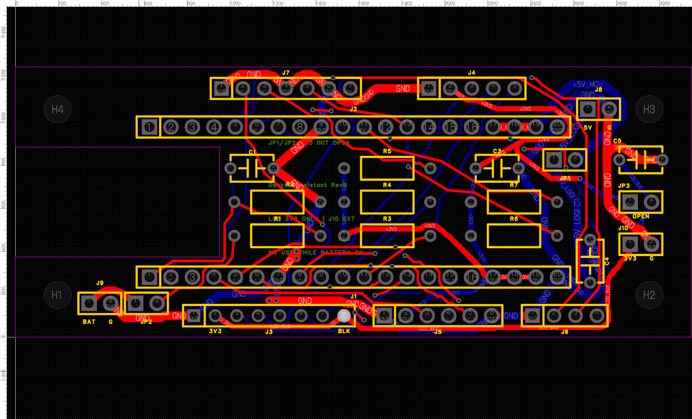
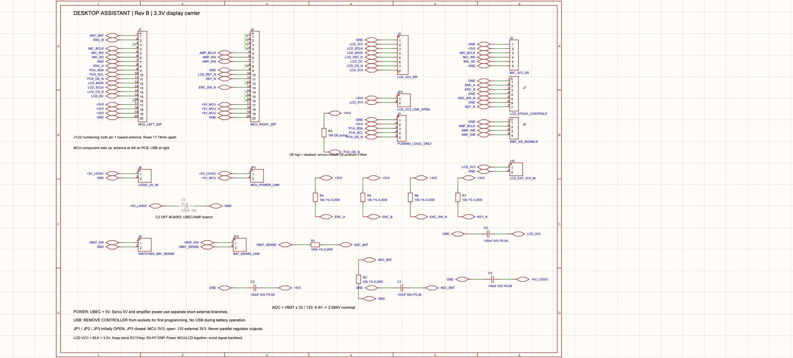

# DesktopAssistant RevB — 屏幕3.3V供电修订复核包

2026-09-09：已在用户现有嘉立创EDA专业版工程中完成原理图及PCB修改，并保存、重开、运行严格DRC及导出复核。当前有效PCB版本为**RevB**，旧RevA的屏幕5V文件已停用。

在线项目仍叫 `DesktopAssistant_RevA`（保留用户工程名称），其中 **Board1 / Schematic1 / P1** 和 **Board1 / PCB1** 已是RevB。板上丝印、图面标题和本目录文件名标识RevB。`Schematic1_1`是保留的历史副本，不是当前设计入口。

[打开在线工程](https://pro.lceda.cn/editor?cll=warn#id=e5e438419c1c4681946d5009bb8d6daf)

## 修改结果

| 部位 | RevB接法 |
|---|---|
| J3.2 屏幕VCC | 从5V移至独立LCD_3V3网络 |
| J3.8 BLK | 从空脚改为LCD_3V3，固定全亮 |
| JP3 新增 | 主控3.3V到LCD_3V3的可选短导线连接；默认断开 |
| J10 新增 | 外部稳压3.3V输入，1脚正、2脚地；使用时JP3断开 |
| C5 新增 | 100nF屏幕供电旁路电容 |
| J7 / R4–R7 | 改为原屏幕板控件接口说明；原板已有上拉，R4–R7默认不焊 |

板框仍为80×32mm、双层、目标1.6mm/1oz；保留天线U形开口和4个Ø3.2mm安装孔。21个原有元件的PCB位置不变，新增3个元件位。A3前盖方案保持：完整屏幕板、原位旋钮/按键、内凹屏幕；本轮没有修改Blender/STL。

**这版没有新增板载稳压器。** 屏幕最大电流尚未确认，所以JP3默认断开；确认主控稳压余量后可以共用其3.3V，否则经J10接独立稳压3.3V。两个稳压输出不能并联。完整接线、初装数量和上电步骤见[装配与上电核对](装配与上电核对.md)。

## 复核结果

- 原理图及PCB原生严格DRC均通过，错误列表为空；保存、关闭、重开后已复核。
- 104个元件焊盘的原理图、PCB网表和归档网络逐一一致；26/26条网络连通，11个NC按设计隔离，无孤立铜。
- 用原生归档封装精确尺寸检查：最小异网铜间距8.0001mil，铜到板/槽边最小13.0157mil；未放宽8mil间距及12mil板边规则。尺寸结果不包含制造公差。
- Gerber内752条铜线、104个元件孔、25个过孔、4个NPTH安装孔与工程逐一匹配；GKO为闭合80×32mm带U形开口的板框。
- 原生工程与Gerber的ZIP校验通过。独立过孔钻孔文件是129个PTH孔文件中的25孔子集，勿重复加工。
- 导出省略两个无自定义值的默认网络规则记录；原理图属性的绘制顺序和默认删除线字段也有序列化差异。已记录并核对，所有规则数值、引脚、元件、文字值、坐标和导线一致。

这些结果确认设计文件及本次电气修订通过检查。实物插座/线束/壳体配合、全亮屏幕电流、稳压温升、实际上下电时序及整机负载仍未完成；尚未代下单，也未确认首次硬件必然成功。

## 文件入口

- [原生工程 .epro2](DesktopAssistant_RevB_PCB_review.epro2)：用于嘉立创EDA专业版打开/导入。
- [Gerber及钻孔 .zip](DesktopAssistant_RevB_Gerber_review.zip)：本次复核后的制造输出；下单选择双层、1.6mm、1oz，并检查预览尺寸和孔槽加工。
- [装配与上电核对](装配与上电核对.md)：供电模式、接口与初装顺序。
- [屏幕12针接线表](屏幕12针接线表.csv)、[全部104针及坐标](载板接口与引脚.csv)、[载板装配清单](载板装配清单.csv)。
- [修改与复核报告](修改与复核报告.md)：检查范围和未完成事项。
- `carrier-definition.json`、`screen-interface.json`：可供后续设计/固件使用的本版定义。
- `native-pcb-drc.json`、`native-schematic-drc.json`、`native-routing-validation.json`、`netlist-check.json`、`native-archive-check.json`、`gerber-export-check.json`：原始检查结果。
- `delivery-manifest.json`：本次交付状态与文件校验值。

工作目录的 `before/` 保存修改前备份；`audit/` 记录本次API操作。`revise_schematic.py` / `apply_local_routing.py` 是仅适用于修改前状态的一次性脚本，不能在当前工程上重跑。交付ZIP不含历史工程或执行审计大文件。
